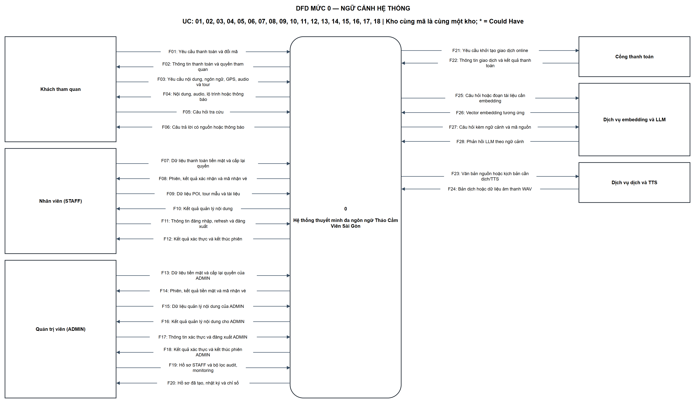
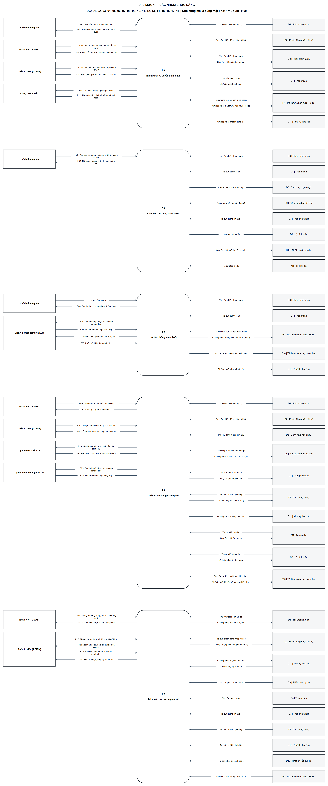
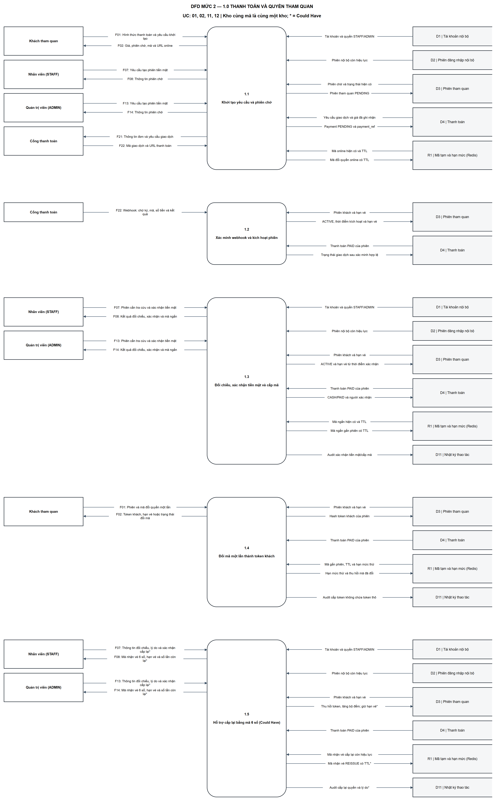
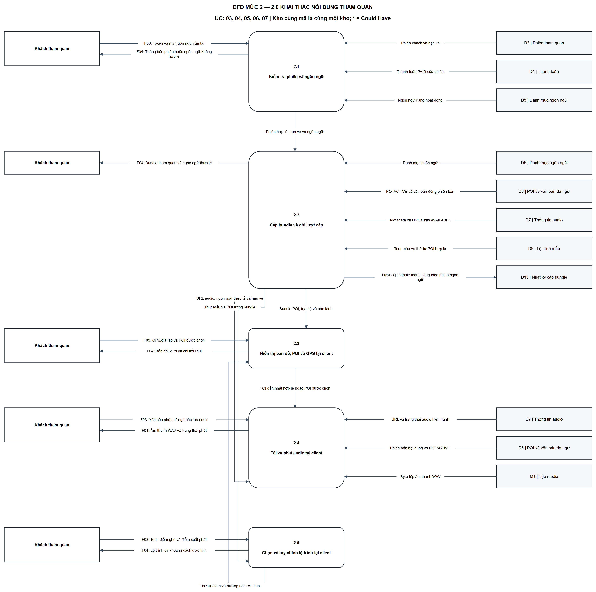
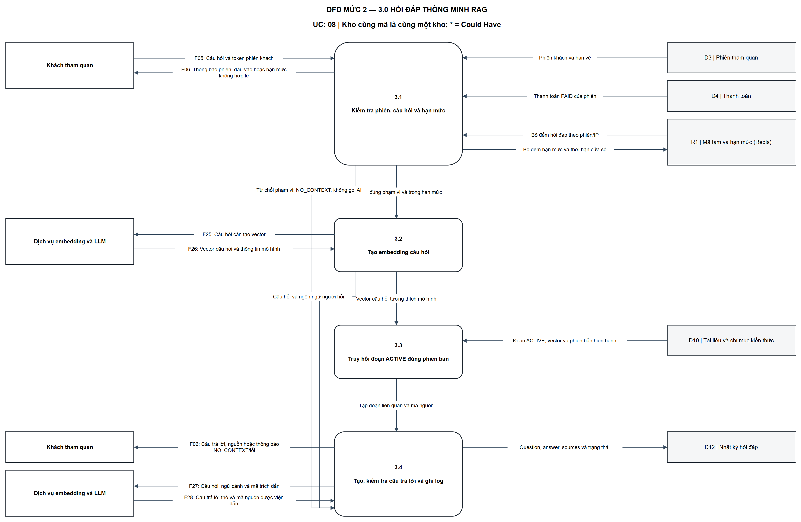
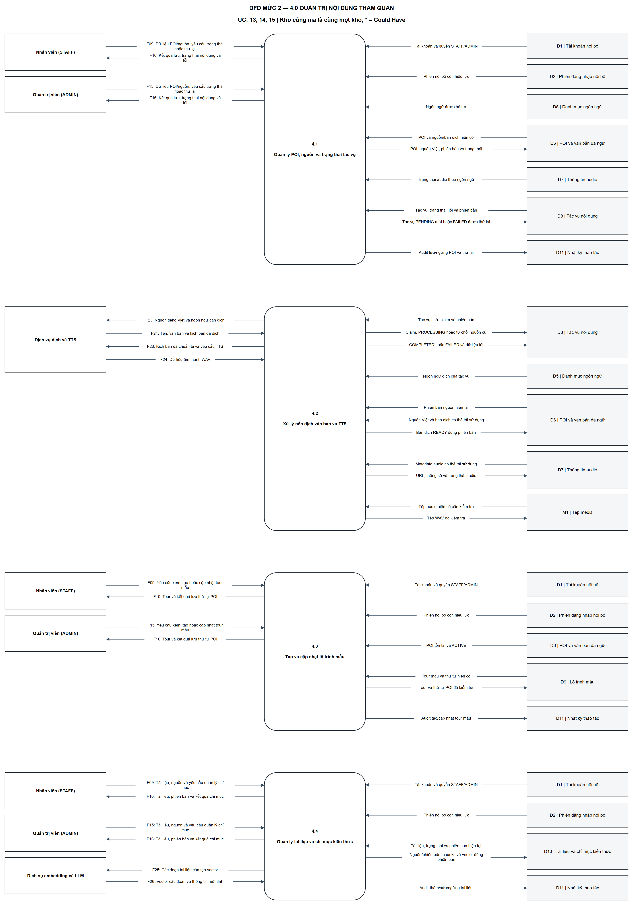
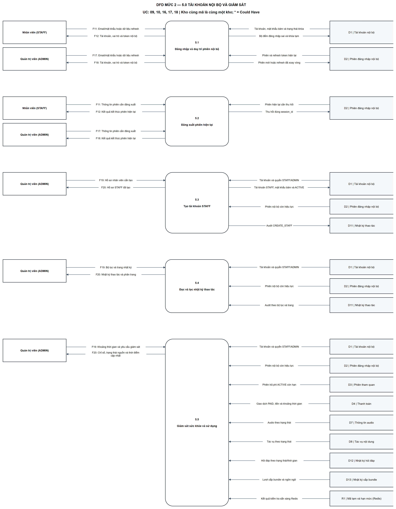
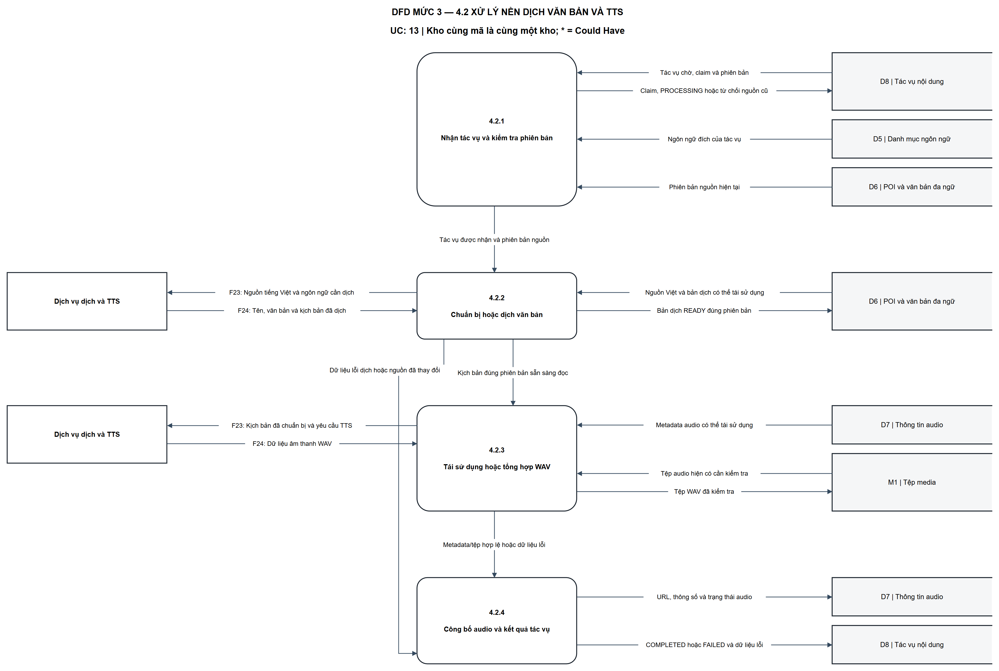
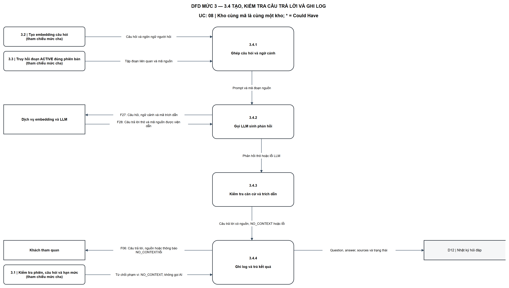

### 3.4. Sơ đồ luồng dữ liệu DFD

Phần này phân tích các luồng theo UC-01–UC-18 và QT-01–QT-14 của báo cáo Thảo Cầm Viên Sài Gòn. Ranh giới gồm web khách, giao diện nội bộ, backend, MySQL, Redis và media; GPS, phát audio và tour tùy chỉnh nằm trong xử lý tại client. Sáu tác nhân ngoài trao đổi với năm nhóm chức năng; 13 kho logic ánh xạ đúng 16 bảng, tách riêng Redis và tệp media.

#### 3.4.1. Sơ đồ DFD mức 0

Sơ đồ mức 0 biểu diễn một tiến trình hệ thống và sáu tác nhân ngoài. Các họ F01–F28 bao gồm dữ liệu xác thực/đăng xuất của STAFF và ADMIN, quyền ADMIN kế thừa STAFF, thanh toán, nội dung, embedding câu hỏi/tài liệu và phản hồi LLM. Bảng thành phần cho phép gộp/tách luồng khi phân rã mà không mất dữ liệu.

*Hình 3.38: Sơ đồ DFD mức 0 ngữ cảnh hệ thống*

*Bảng 3.19: Bảng mô tả luồng dữ liệu DFD mức 0*

| Mã họ luồng | Hướng truyền dữ liệu | Tên luồng dữ liệu | Thành phần nghiệp vụ |
| :--- | :--- | :--- | :--- |
| F01 | Khách tham quan → Hệ thống (0) | Yêu cầu thanh toán và đổi mã | Hình thức thanh toán và yêu cầu khởi tạo; Phiên và mã đổi quyền một lần |
| F02 | Hệ thống (0) → Khách tham quan | Thông tin thanh toán và quyền tham quan | Giá, phiên chờ, mã và URL online; Token khách, hạn vé hoặc trạng thái đổi mã |
| F07 | Nhân viên (STAFF) → Hệ thống (0) | Dữ liệu thanh toán tiền mặt và cấp lại quyền | Yêu cầu tạo phiên tiền mặt; Phiên cần tra cứu và xác nhận tiền mặt; Thông tin đối chiếu, lý do và xác nhận cấp lại* |
| F08 | Hệ thống (0) → Nhân viên (STAFF) | Phiên, kết quả xác nhận và mã nhận vé | Thông tin phiên chờ; Kết quả đối chiếu, xác nhận và mã ngắn; Mã nhận vé 6 số, hạn vé và số lần còn lại* |
| F13 | Quản trị viên (ADMIN) → Hệ thống (0) | Dữ liệu tiền mặt và cấp lại quyền của ADMIN | Yêu cầu tạo phiên tiền mặt; Phiên cần tra cứu và xác nhận tiền mặt; Thông tin đối chiếu, lý do và xác nhận cấp lại* |
| F14 | Hệ thống (0) → Quản trị viên (ADMIN) | Phiên, kết quả tiền mặt và mã nhận vé | Thông tin phiên chờ; Kết quả đối chiếu, xác nhận và mã ngắn; Mã nhận vé 6 số, hạn vé và số lần còn lại* |
| F21 | Hệ thống (0) → Cổng thanh toán | Yêu cầu khởi tạo giao dịch online | Thông tin đơn và yêu cầu giao dịch |
| F22 | Cổng thanh toán → Hệ thống (0) | Thông tin giao dịch và kết quả thanh toán | Mã giao dịch và URL thanh toán; Webhook: chữ ký, mã, số tiền và kết quả |
| F03 | Khách tham quan → Hệ thống (0) | Yêu cầu nội dung, ngôn ngữ, GPS, audio và tour | Token và mã ngôn ngữ cần tải; GPS/giả lập và POI được chọn; Yêu cầu phát, dừng hoặc tua audio; Tour, điểm ghé và điểm xuất phát |
| F04 | Hệ thống (0) → Khách tham quan | Nội dung, audio, lộ trình hoặc thông báo | Bundle tham quan và ngôn ngữ thực tế; Bản đồ, vị trí và chi tiết POI; Âm thanh WAV và trạng thái phát; Lộ trình và khoảng cách ước tính; Thông báo phiên hoặc ngôn ngữ không hợp lệ |
| F05 | Khách tham quan → Hệ thống (0) | Câu hỏi tra cứu | Câu hỏi và token phiên khách |
| F06 | Hệ thống (0) → Khách tham quan | Câu trả lời có nguồn hoặc thông báo | Thông báo phiên, đầu vào hoặc hạn mức không hợp lệ; Câu trả lời, nguồn hoặc thông báo NO_CONTEXT/lỗi |
| F25 | Hệ thống (0) → Dịch vụ embedding và LLM | Câu hỏi hoặc đoạn tài liệu cần embedding | Câu hỏi cần tạo vector; Các đoạn tài liệu cần tạo vector |
| F26 | Dịch vụ embedding và LLM → Hệ thống (0) | Vector embedding tương ứng | Vector câu hỏi và thông tin mô hình; Vector các đoạn và thông tin mô hình |
| F27 | Hệ thống (0) → Dịch vụ embedding và LLM | Câu hỏi kèm ngữ cảnh và mã nguồn | Câu hỏi, ngữ cảnh và mã trích dẫn |
| F28 | Dịch vụ embedding và LLM → Hệ thống (0) | Phản hồi LLM theo ngữ cảnh | Câu trả lời thô và mã nguồn được viện dẫn |
| F09 | Nhân viên (STAFF) → Hệ thống (0) | Dữ liệu POI, tour mẫu và tài liệu | Dữ liệu POI/nguồn, yêu cầu trạng thái hoặc thử lại; Yêu cầu xem, tạo hoặc cập nhật tour mẫu; Tài liệu, nguồn và yêu cầu quản lý chỉ mục |
| F10 | Hệ thống (0) → Nhân viên (STAFF) | Kết quả quản lý nội dung | Kết quả lưu, trạng thái nội dung và lỗi; Tour và kết quả lưu thứ tự POI; Tài liệu, phiên bản và kết quả chỉ mục |
| F15 | Quản trị viên (ADMIN) → Hệ thống (0) | Dữ liệu quản lý nội dung của ADMIN | Dữ liệu POI/nguồn, yêu cầu trạng thái hoặc thử lại; Yêu cầu xem, tạo hoặc cập nhật tour mẫu; Tài liệu, nguồn và yêu cầu quản lý chỉ mục |
| F16 | Hệ thống (0) → Quản trị viên (ADMIN) | Kết quả quản lý nội dung cho ADMIN | Kết quả lưu, trạng thái nội dung và lỗi; Tour và kết quả lưu thứ tự POI; Tài liệu, phiên bản và kết quả chỉ mục |
| F23 | Hệ thống (0) → Dịch vụ dịch và TTS | Văn bản nguồn hoặc kịch bản cần dịch/TTS | Nguồn tiếng Việt và ngôn ngữ cần dịch; Kịch bản đã chuẩn bị và yêu cầu TTS |
| F24 | Dịch vụ dịch và TTS → Hệ thống (0) | Bản dịch hoặc dữ liệu âm thanh WAV | Tên, văn bản và kịch bản đã dịch; Dữ liệu âm thanh WAV |
| F11 | Nhân viên (STAFF) → Hệ thống (0) | Thông tin đăng nhập, refresh và đăng xuất | Email/mật khẩu hoặc dữ liệu refresh; Thông tin phiên cần đăng xuất |
| F12 | Hệ thống (0) → Nhân viên (STAFF) | Kết quả xác thực và kết thúc phiên | Tài khoản, vai trò và token nội bộ; Kết quả kết thúc phiên hiện tại |
| F17 | Quản trị viên (ADMIN) → Hệ thống (0) | Thông tin xác thực và đăng xuất ADMIN | Email/mật khẩu hoặc dữ liệu refresh; Thông tin phiên cần đăng xuất |
| F18 | Hệ thống (0) → Quản trị viên (ADMIN) | Kết quả xác thực và kết thúc phiên ADMIN | Tài khoản, vai trò và token nội bộ; Kết quả kết thúc phiên hiện tại |
| F19 | Quản trị viên (ADMIN) → Hệ thống (0) | Hồ sơ STAFF và bộ lọc audit, monitoring | Hồ sơ nhân viên cần tạo; Bộ lọc và trang nhật ký; Khoảng thời gian và yêu cầu giám sát |
| F20 | Hệ thống (0) → Quản trị viên (ADMIN) | Hồ sơ đã tạo, nhật ký và chỉ số | Hồ sơ STAFF đã tạo; Nhật ký thao tác và phân trang; Chỉ số, trạng thái nguồn và thời điểm cập nhật |

---

#### 3.4.2. Sơ đồ DFD mức 1

Sơ đồ mức 1 gồm 1.0 thanh toán/quyền khách, 2.0 khai thác nội dung, 3.0 RAG, 4.0 quản trị nội dung và 5.0 tài khoản/giám sát. Từng nhóm truy vết use case tương ứng; yêu cầu tour, tài liệu, audit và monitoring đi vào đúng chức năng, không đi qua tiến trình đăng nhập hay cập nhật POI để điều phối.

*Hình 3.39: Sơ đồ DFD mức 1 phân rã toàn hệ thống*

*Bảng 3.20: Ánh xạ kho dữ liệu logic với cấu trúc lưu trữ vật lý*

| Mã kho | Tên kho logic | Lưu trữ vật lý | Phạm vi sử dụng |
| :--- | :--- | :--- | :--- |
| D1 | Tài khoản nội bộ | USERS | Dữ liệu nghiệp vụ Chương 4 |
| D2 | Phiên đăng nhập nội bộ | REFRESH_TOKENS | Dữ liệu nghiệp vụ Chương 4 |
| D3 | Phiên tham quan | VISIT_SESSIONS | Dữ liệu nghiệp vụ Chương 4 |
| D4 | Thanh toán | PAYMENTS | Dữ liệu nghiệp vụ Chương 4 |
| D5 | Danh mục ngôn ngữ | LANGUAGES | Dữ liệu nghiệp vụ Chương 4 |
| D6 | POI và văn bản đa ngữ | POIS, POI_TRANSLATIONS | Dữ liệu nghiệp vụ Chương 4 |
| D7 | Thông tin audio | AUDIOS | Dữ liệu nghiệp vụ Chương 4 |
| D8 | Tác vụ nội dung | CONTENT_JOBS | Dữ liệu nghiệp vụ Chương 4 |
| D9 | Lộ trình mẫu | TOURS, TOUR_POIS | Dữ liệu nghiệp vụ Chương 4 |
| D10 | Tài liệu và chỉ mục kiến thức | KNOWLEDGE_DOCUMENTS, KNOWLEDGE_CHUNKS | Dữ liệu nghiệp vụ Chương 4 |
| D11 | Nhật ký thao tác | AUDIT_LOGS | Dữ liệu nghiệp vụ Chương 4 |
| D12 | Nhật ký hỏi đáp | CHAT_LOGS | Dữ liệu nghiệp vụ Chương 4 |
| D13 | Nhật ký cấp bundle | BUNDLE_ACCESS_LOGS | Dữ liệu nghiệp vụ Chương 4 |
| R1 | Mã tạm và hạn mức (Redis) | Redis có TTL | Mã tạm và hạn mức; tách khỏi MySQL |
| M1 | Tệp media | Kho tệp media | Byte tệp; metadata nằm ở AUDIOS/POI |

Các kho D1–D13 có ánh xạ vật lý trong Bảng 3.20; R1 là dữ liệu tạm Redis và M1 là tệp media. AUDIT_LOGS, CHAT_LOGS và BUNDLE_ACCESS_LOGS được phân biệt; monitoring đọc các bảng nghiệp vụ phù hợp. Không đưa ANALYTICS_* hoặc thu thập GPS định kỳ vào mô hình báo cáo. UC-12 vẫn là phần Could Have, bàn giao bằng mã nhận vé 6 số; các giá trị triển khai được ghi theo cấu hình.

*Bảng 3.21: Bảng mô tả năm tiến trình chính trong DFD mức 1*

| Số hiệu | Tên tiến trình và UC | Luồng dữ liệu đầu vào | Kho dữ liệu đọc/ghi | Luồng dữ liệu đầu ra |
| :--- | :--- | :--- | :--- | :--- |
| 1.0 | Thanh toán và quyền tham quan (UC-01, UC-02, UC-11, UC-12) | Khách tham quan → Yêu cầu thanh toán và đổi mã; Nhân viên (STAFF) → Dữ liệu thanh toán tiền mặt và cấp lại quyền; Quản trị viên (ADMIN) → Dữ liệu tiền mặt và cấp lại quyền của ADMIN; Cổng thanh toán → Thông tin giao dịch và kết quả thanh toán | Đọc D1; Đọc D2; Đọc D3; Đọc D4; Đọc R1; Ghi D3; Ghi D4; Ghi R1; Ghi D11 | Thông tin thanh toán và quyền tham quan → Khách tham quan; Phiên, kết quả xác nhận và mã nhận vé → Nhân viên (STAFF); Phiên, kết quả tiền mặt và mã nhận vé → Quản trị viên (ADMIN); Yêu cầu khởi tạo giao dịch online → Cổng thanh toán |
| 2.0 | Khai thác nội dung tham quan (UC-03, UC-04, UC-05, UC-06, UC-07) | Khách tham quan → Yêu cầu nội dung, ngôn ngữ, GPS, audio và tour | Đọc D3; Đọc D4; Đọc D5; Đọc D6; Đọc D7; Đọc D9; Ghi D13; Đọc M1 | Nội dung, audio, lộ trình hoặc thông báo → Khách tham quan |
| 3.0 | Hỏi đáp thông minh RAG (UC-08) | Khách tham quan → Câu hỏi tra cứu; Dịch vụ embedding và LLM → Vector embedding tương ứng; Dịch vụ embedding và LLM → Phản hồi LLM theo ngữ cảnh | Đọc D3; Đọc D4; Đọc R1; Ghi R1; Đọc D10; Ghi D12 | Câu trả lời có nguồn hoặc thông báo → Khách tham quan; Câu hỏi hoặc đoạn tài liệu cần embedding → Dịch vụ embedding và LLM; Câu hỏi kèm ngữ cảnh và mã nguồn → Dịch vụ embedding và LLM |
| 4.0 | Quản trị nội dung tham quan (UC-13, UC-14, UC-15) | Nhân viên (STAFF) → Dữ liệu POI, tour mẫu và tài liệu; Quản trị viên (ADMIN) → Dữ liệu quản lý nội dung của ADMIN; Dịch vụ dịch và TTS → Bản dịch hoặc dữ liệu âm thanh WAV; Dịch vụ embedding và LLM → Vector embedding tương ứng | Đọc D1; Đọc D2; Đọc D5; Đọc D6; Đọc D7; Đọc D8; Ghi D6; Ghi D8; Ghi D11; Đọc M1; Ghi M1; Ghi D7; Đọc D9; Ghi D9; Đọc D10; Ghi D10 | Kết quả quản lý nội dung → Nhân viên (STAFF); Kết quả quản lý nội dung cho ADMIN → Quản trị viên (ADMIN); Văn bản nguồn hoặc kịch bản cần dịch/TTS → Dịch vụ dịch và TTS; Câu hỏi hoặc đoạn tài liệu cần embedding → Dịch vụ embedding và LLM |
| 5.0 | Tài khoản nội bộ và giám sát (UC-09, UC-10, UC-16, UC-17, UC-18) | Nhân viên (STAFF) → Thông tin đăng nhập, refresh và đăng xuất; Quản trị viên (ADMIN) → Thông tin xác thực và đăng xuất ADMIN; Quản trị viên (ADMIN) → Hồ sơ STAFF và bộ lọc audit, monitoring | Đọc D1; Ghi D1; Đọc D2; Ghi D2; Ghi D11; Đọc D11; Đọc D3; Đọc D4; Đọc D7; Đọc D8; Đọc D12; Đọc D13; Đọc R1 | Kết quả xác thực và kết thúc phiên → Nhân viên (STAFF); Kết quả xác thực và kết thúc phiên ADMIN → Quản trị viên (ADMIN); Hồ sơ đã tạo, nhật ký và chỉ số → Quản trị viên (ADMIN) |

---

#### 3.4.3. Sơ đồ DFD mức 2

DFD mức 2 phân rã chi tiết từng tiến trình trong năm tiến trình chính ở mức 1 thành các tiến trình con xử lý các bước nghiệp vụ cụ thể.

a. Phân rã tiến trình 1.0 Quản lý thanh toán và phiên tham quan

Tiến trình 1.0 phân rã thành năm tiến trình 1.1–1.5 theo UC-01, UC-02, UC-11 và UC-12 (Could Have). Thông tin khởi tạo trả trước khi đổi token; webhook hợp lệ và xác nhận tiền mặt kích hoạt đúng phiên chờ. Cấp lại giữ hạn vé và bàn giao mã 6 số để khách tự đổi token.

*Hình 3.40: Sơ đồ DFD mức 2 tiến trình 1.0 Quản lý thanh toán và phiên tham quan*

*Bảng 3.22: Bảng mô tả các tiến trình con trong DFD mức 2 của tiến trình 1.0*

| Số hiệu | Tên tiến trình và UC | Luồng dữ liệu đầu vào | Xử lý nghiệp vụ | Luồng dữ liệu đầu ra |
| :--- | :--- | :--- | :--- | :--- |
| 1.1 | Khởi tạo yêu cầu và phiên chờ (UC-01, UC-02, UC-11) | Khách tham quan → Hình thức thanh toán và yêu cầu khởi tạo; Nhân viên (STAFF) → Yêu cầu tạo phiên tiền mặt; Quản trị viên (ADMIN) → Yêu cầu tạo phiên tiền mặt; Cổng thanh toán → Mã giao dịch và URL thanh toán; D1 → Tài khoản và quyền STAFF/ADMIN; D2 → Phiên nội bộ còn hiệu lực; D3 → Phiên chờ và trạng thái hiện có; D4 → Yêu cầu giao dịch và giá đã ghi nhận; R1 → Mã online hiện có và TTL | Tạo hoặc dùng lại đúng phiên/payment chờ, giá do server xác định; trả thông tin khởi tạo trước khi đổi token. | Giá, phiên chờ, mã và URL online → Khách tham quan; Thông tin phiên chờ → Nhân viên (STAFF); Thông tin phiên chờ → Quản trị viên (ADMIN); Thông tin đơn và yêu cầu giao dịch → Cổng thanh toán; Phiên tham quan PENDING → D3; Payment PENDING và payment_ref → D4; Mã đổi quyền online có TTL → R1 |
| 1.2 | Xác minh webhook và kích hoạt phiên (UC-01) | Cổng thanh toán → Webhook: chữ ký, mã, số tiền và kết quả; D3 → Phiên khách và hạn vé; D4 → Thanh toán PAID của phiên | Xác minh chữ ký, mã giao dịch và số tiền; cập nhật payment và kích hoạt đúng phiên nguyên tử; chống thông báo lặp. | Trạng thái giao dịch sau xác minh hợp lệ → D4; ACTIVE, thời điểm kích hoạt và hạn vé → D3 |
| 1.3 | Đối chiếu, xác nhận tiền mặt và cấp mã (UC-11) | Nhân viên (STAFF) → Phiên cần tra cứu và xác nhận tiền mặt; Quản trị viên (ADMIN) → Phiên cần tra cứu và xác nhận tiền mặt; D1 → Tài khoản và quyền STAFF/ADMIN; D2 → Phiên nội bộ còn hiệu lực; D3 → Phiên khách và hạn vé; D4 → Thanh toán PAID của phiên; R1 → Mã ngắn hiện có và TTL | Tra cứu đúng phiên, kiểm tra quyền và tiền đã nhận; xác nhận PAID/ACTIVE cùng audit, sau đó cấp mã ngắn Redis. | Kết quả đối chiếu, xác nhận và mã ngắn → Nhân viên (STAFF); Kết quả đối chiếu, xác nhận và mã ngắn → Quản trị viên (ADMIN); CASH/PAID và người xác nhận → D4; ACTIVE và hạn vé từ thời điểm xác nhận → D3; Mã ngắn gắn phiên có TTL → R1; Audit xác nhận tiền mặt/cấp mã → D11 |
| 1.4 | Đổi mã một lần thành token khách (UC-01, UC-02, UC-12) | Khách tham quan → Phiên và mã đổi quyền một lần; D3 → Phiên khách và hạn vé; D4 → Thanh toán PAID của phiên; R1 → Mã gắn phiên, TTL và hạn mức thử | Kiểm tra mã/phiên/TTL/hạn mức; chỉ PAID còn hạn mới đổi một lần. Giữ mã khi giao dịch còn PENDING. | Token khách, hạn vé hoặc trạng thái đổi mã → Khách tham quan; Hash token khách của phiên → D3; Hạn mức thử và thu hồi mã đã đổi → R1; Audit cấp token không chứa token thô → D11 |
| 1.5 | Hỗ trợ cấp lại bằng mã 6 số (Could Have) (UC-12) | Nhân viên (STAFF) → Thông tin đối chiếu, lý do và xác nhận cấp lại*; Quản trị viên (ADMIN) → Thông tin đối chiếu, lý do và xác nhận cấp lại*; D1 → Tài khoản và quyền STAFF/ADMIN; D2 → Phiên nội bộ còn hiệu lực; D3 → Phiên khách và hạn vé; D4 → Thanh toán PAID của phiên; R1 → Mã nhận vé cấp lại còn hiệu lực | Could Have: đối chiếu giao dịch, giữ hạn vé, thu hồi token cũ và tăng bộ đếm đúng một lần; bàn giao mã nhận vé 6 số. | Mã nhận vé 6 số, hạn vé và số lần còn lại* → Nhân viên (STAFF); Mã nhận vé 6 số, hạn vé và số lần còn lại* → Quản trị viên (ADMIN); Thu hồi token, tăng bộ đếm; giữ hạn vé* → D3; Mã nhận vé REISSUE có TTL* → R1; Audit cấp lại quyền và lý do* → D11 |

b. Phân rã tiến trình 2.0 Cung cấp nội dung bản đồ, lộ trình và thuyết minh

Tiến trình 2.0 phân rã thành năm tiến trình 2.1–2.5 theo UC-03–UC-07. Bundle chứa dữ liệu và URL media; tải/phát WAV là luồng riêng. GPS, chống lặp audio và sắp tour tùy chỉnh dùng dữ liệu tại client; không có luồng ghi vị trí hay tour cá nhân vào database.

*Hình 3.41: Sơ đồ DFD mức 2 tiến trình 2.0 Cung cấp nội dung bản đồ, lộ trình và thuyết minh*

*Bảng 3.23: Bảng mô tả các tiến trình con trong DFD mức 2 của tiến trình 2.0*

| Số hiệu | Tên tiến trình và UC | Luồng dữ liệu đầu vào | Xử lý nghiệp vụ | Luồng dữ liệu đầu ra |
| :--- | :--- | :--- | :--- | :--- |
| 2.1 | Kiểm tra phiên và ngôn ngữ (UC-03, UC-04) | Khách tham quan → Token và mã ngôn ngữ cần tải; D3 → Phiên khách và hạn vé; D4 → Thanh toán PAID của phiên; D5 → Ngôn ngữ đang hoạt động | Kiểm tra phiên trả phí còn hạn và ngôn ngữ đang hoạt động. | Thông báo phiên hoặc ngôn ngữ không hợp lệ → Khách tham quan; Phiên hợp lệ, hạn vé và ngôn ngữ → 2.2 |
| 2.2 | Cấp bundle và ghi lượt cấp (UC-03, UC-04, UC-05, UC-06, UC-07) | 2.1 → Phiên hợp lệ, hạn vé và ngôn ngữ; D5 → Danh mục ngôn ngữ; D6 → POI ACTIVE và văn bản đúng phiên bản; D7 → Metadata và URL audio AVAILABLE; D9 → Tour mẫu và thứ tự POI hợp lệ | Đọc nội dung hiện hành, fallback có nhãn, cấp bundle chứa URL media và ghi lượt cấp thành công; không ghép byte audio. | Bundle tham quan và ngôn ngữ thực tế → Khách tham quan; Lượt cấp bundle thành công theo phiên/ngôn ngữ → D13; Bundle POI, tọa độ và bán kính → 2.3; URL audio, ngôn ngữ thực tế và hạn vé → 2.4; Tour mẫu và POI trong bundle → 2.5 |
| 2.3 | Hiển thị bản đồ, POI và GPS tại client (UC-03, UC-05, UC-06, UC-07) | Khách tham quan → GPS/giả lập và POI được chọn; 2.2 → Bundle POI, tọa độ và bán kính; 2.5 → Thứ tự điểm và đường nối ước tính | Hiển thị từ bundle; tính khoảng cách và nhận diện vùng kích hoạt bằng GPS/giả lập tại trình duyệt; không gửi GPS định kỳ. | Bản đồ, vị trí và chi tiết POI → Khách tham quan; POI gần nhất hợp lệ hoặc POI được chọn → 2.4 |
| 2.4 | Tải và phát audio tại client (UC-04, UC-05, UC-06) | Khách tham quan → Yêu cầu phát, dừng hoặc tua audio; 2.2 → URL audio, ngôn ngữ thực tế và hạn vé; 2.3 → POI gần nhất hợp lệ hoặc POI được chọn; D7 → URL và trạng thái audio hiện hành; D6 → Phiên bản nội dung và POI ACTIVE; M1 → Byte tệp âm thanh WAV | Tải tệp qua URL, phát/dừng/tua; tự phát cần tương tác mở khóa, chọn điểm hợp lệ và chống lặp sau khi phát thành công. | Âm thanh WAV và trạng thái phát → Khách tham quan |
| 2.5 | Chọn và tùy chỉnh lộ trình tại client (UC-07) | Khách tham quan → Tour, điểm ghé và điểm xuất phát; 2.2 → Tour mẫu và POI trong bundle | Giữ thứ tự tour mẫu; với tour tùy chỉnh dùng nearest-neighbor/Haversine tại client. Không ghi tour riêng vào database. | Lộ trình và khoảng cách ước tính → Khách tham quan; Thứ tự điểm và đường nối ước tính → 2.3 |

c. Phân rã tiến trình 3.0 Xử lý hỏi đáp thông minh RAG

Tiến trình 3.0 phân rã thành bốn tiến trình 3.1–3.4 theo UC-08: kiểm tra phiên/câu hỏi/hạn mức, tạo embedding câu hỏi, truy hồi nguồn ACTIVE đúng phiên bản, rồi gọi LLM và ghi CHAT_LOGS. Cặp trao đổi embedding trước truy hồi tách khỏi cặp trao đổi sinh câu trả lời sau truy hồi.

*Hình 3.42: Sơ đồ DFD mức 2 tiến trình 3.0 Xử lý hỏi đáp thông minh RAG*

*Bảng 3.24: Bảng mô tả các tiến trình con trong DFD mức 2 của tiến trình 3.0*

| Số hiệu | Tên tiến trình và UC | Luồng dữ liệu đầu vào | Xử lý nghiệp vụ | Luồng dữ liệu đầu ra |
| :--- | :--- | :--- | :--- | :--- |
| 3.1 | Kiểm tra phiên, câu hỏi và hạn mức (UC-08) | Khách tham quan → Câu hỏi và token phiên khách; D3 → Phiên khách và hạn vé; D4 → Thanh toán PAID của phiên; R1 → Bộ đếm hỏi đáp theo phiên/IP | Kiểm tra phiên, đầu vào và hạn mức Redis theo phiên/IP; từ chối sai quyền/phạm vi trước khi xử lý phù hợp. | Thông báo phiên, đầu vào hoặc hạn mức không hợp lệ → Khách tham quan; Bộ đếm hạn mức và thời hạn cửa sổ → R1; Câu hỏi đúng phạm vi và trong hạn mức → 3.2; Từ chối phạm vi: NO_CONTEXT, không gọi AI → 3.4 |
| 3.2 | Tạo embedding câu hỏi (UC-08) | Dịch vụ embedding và LLM → Vector câu hỏi và thông tin mô hình; 3.1 → Câu hỏi đúng phạm vi và trong hạn mức | Gọi dịch vụ embedding cho câu hỏi và kiểm tra vector tương thích; chưa gọi LLM ở bước này. | Câu hỏi cần tạo vector → Dịch vụ embedding và LLM; Vector câu hỏi tương thích mô hình → 3.3; Câu hỏi và ngôn ngữ người hỏi → 3.4 |
| 3.3 | Truy hồi đoạn ACTIVE đúng phiên bản (UC-08) | 3.2 → Vector câu hỏi tương thích mô hình; D10 → Đoạn ACTIVE, vector và phiên bản hiện hành | So sánh vector với các đoạn của tài liệu ACTIVE, đúng content_version/source_version và mô hình tương thích. | Tập đoạn liên quan và mã nguồn → 3.4 |
| 3.4 | Tạo, kiểm tra câu trả lời và ghi log (UC-08) | Dịch vụ embedding và LLM → Câu trả lời thô và mã nguồn được viện dẫn; 3.1 → Từ chối phạm vi: NO_CONTEXT, không gọi AI; 3.2 → Câu hỏi và ngôn ngữ người hỏi; 3.3 → Tập đoạn liên quan và mã nguồn | Ghép câu hỏi với ngữ cảnh, gọi LLM, kiểm tra nguồn và ghi SUCCESS/NO_CONTEXT/FAILED trước khi trả kết quả. | Câu trả lời, nguồn hoặc thông báo NO_CONTEXT/lỗi → Khách tham quan; Câu hỏi, ngữ cảnh và mã trích dẫn → Dịch vụ embedding và LLM; Question, answer, sources và trạng thái → D12 |

d. Phân rã tiến trình 4.0 Quản trị nội dung, lộ trình và kho kiến thức

Tiến trình 4.0 gồm 4.1 POI/nguồn/trạng thái, 4.2 pipeline, 4.3 tour mẫu và 4.4 kho kiến thức theo UC-13–UC-15. STAFF và ADMIN thao tác trực tiếp với đúng chức năng. Tác vụ nền đọc CONTENT_JOBS; bản dịch, metadata audio, tệp và trạng thái tác vụ có kho/luồng riêng.

*Hình 3.43: Sơ đồ DFD mức 2 tiến trình 4.0 Quản trị nội dung, lộ trình và kho kiến thức*

*Bảng 3.25: Bảng mô tả các tiến trình con trong DFD mức 2 của tiến trình 4.0*

| Số hiệu | Tên tiến trình và UC | Luồng dữ liệu đầu vào | Xử lý nghiệp vụ | Luồng dữ liệu đầu ra |
| :--- | :--- | :--- | :--- | :--- |
| 4.1 | Quản lý POI, nguồn và trạng thái tác vụ (UC-13) | Nhân viên (STAFF) → Dữ liệu POI/nguồn, yêu cầu trạng thái hoặc thử lại; Quản trị viên (ADMIN) → Dữ liệu POI/nguồn, yêu cầu trạng thái hoặc thử lại; D1 → Tài khoản và quyền STAFF/ADMIN; D2 → Phiên nội bộ còn hiệu lực; D5 → Ngôn ngữ được hỗ trợ; D6 → POI và nguồn/bản dịch hiện có; D7 → Trạng thái audio theo ngôn ngữ; D8 → Tác vụ, trạng thái, lỗi và phiên bản | Kiểm tra quyền; đọc/sửa/ngừng POI, xem lỗi hoặc thử lại FAILED hiện hành. Lưu nguồn/audit và tạo tác vụ khi đầu vào liên quan đổi. | Kết quả lưu, trạng thái nội dung và lỗi → Nhân viên (STAFF); Kết quả lưu, trạng thái nội dung và lỗi → Quản trị viên (ADMIN); POI, nguồn Việt, phiên bản và trạng thái → D6; Tác vụ PENDING mới hoặc FAILED được thử lại → D8; Audit lưu/ngừng POI và thử lại → D11 |
| 4.2 | Xử lý nền dịch văn bản và TTS (UC-13) | Dịch vụ dịch và TTS → Tên, văn bản và kịch bản đã dịch; Dịch vụ dịch và TTS → Dữ liệu âm thanh WAV; D8 → Tác vụ chờ, claim và phiên bản; D5 → Ngôn ngữ đích của tác vụ; D6 → Phiên bản nguồn hiện tại; D6 → Nguồn Việt và bản dịch có thể tái sử dụng; D7 → Metadata audio có thể tái sử dụng; M1 → Tệp audio hiện có cần kiểm tra | Nhận tác vụ từ CONTENT_JOBS, kiểm tra phiên bản; tái sử dụng hoặc dịch, TTS, kiểm tra/lưu WAV và công bố kết quả hiện hành. | Nguồn tiếng Việt và ngôn ngữ cần dịch → Dịch vụ dịch và TTS; Kịch bản đã chuẩn bị và yêu cầu TTS → Dịch vụ dịch và TTS; Claim, PROCESSING hoặc từ chối nguồn cũ → D8; Bản dịch READY đúng phiên bản → D6; Tệp WAV đã kiểm tra → M1; URL, thông số và trạng thái audio → D7; COMPLETED hoặc FAILED và dữ liệu lỗi → D8 |
| 4.3 | Tạo và cập nhật lộ trình mẫu (UC-14) | Nhân viên (STAFF) → Yêu cầu xem, tạo hoặc cập nhật tour mẫu; Quản trị viên (ADMIN) → Yêu cầu xem, tạo hoặc cập nhật tour mẫu; D1 → Tài khoản và quyền STAFF/ADMIN; D2 → Phiên nội bộ còn hiệu lực; D6 → POI tồn tại và ACTIVE; D9 → Tour mẫu và thứ tự hiện có | Đọc tour hiện có và POI ACTIVE, kiểm tra thứ tự/điểm trùng; lưu TOURS/TOUR_POIS cùng audit. Không thêm xóa/duyệt tour. | Tour và kết quả lưu thứ tự POI → Nhân viên (STAFF); Tour và kết quả lưu thứ tự POI → Quản trị viên (ADMIN); Tour và thứ tự POI đã kiểm tra → D9; Audit tạo/cập nhật tour mẫu → D11 |
| 4.4 | Quản lý tài liệu và chỉ mục kiến thức (UC-15) | Nhân viên (STAFF) → Tài liệu, nguồn và yêu cầu quản lý chỉ mục; Quản trị viên (ADMIN) → Tài liệu, nguồn và yêu cầu quản lý chỉ mục; Dịch vụ embedding và LLM → Vector các đoạn và thông tin mô hình; D1 → Tài khoản và quyền STAFF/ADMIN; D2 → Phiên nội bộ còn hiệu lực; D10 → Tài liệu, trạng thái và phiên bản hiện tại | Lưu nguồn/phiên bản và audit ở pha 1; chia đoạn, tạo embedding ngoài transaction; kiểm tra lại phiên bản và lưu chỉ mục ở pha 2. | Tài liệu, phiên bản và kết quả chỉ mục → Nhân viên (STAFF); Tài liệu, phiên bản và kết quả chỉ mục → Quản trị viên (ADMIN); Các đoạn tài liệu cần tạo vector → Dịch vụ embedding và LLM; Nguồn/phiên bản; chunks và vector đúng phiên bản → D10; Audit thêm/sửa/ngừng tài liệu → D11 |

e. Phân rã tiến trình 5.0 Quản trị tài khoản nội bộ và giám sát hệ thống

Tiến trình 5.0 gồm năm tiến trình 5.1–5.5 theo UC-09, UC-10 và UC-16–UC-18. STAFF/ADMIN đăng nhập và đăng xuất; chỉ ADMIN tạo STAFF, đọc audit và monitoring. Phiên nội bộ được lưu/thu hồi tại REFRESH_TOKENS; monitoring tổng hợp từ các bảng nghiệp vụ thay vì kho thống kê giả định.

*Hình 3.44: Sơ đồ DFD mức 2 tiến trình 5.0 Quản trị tài khoản nội bộ và giám sát hệ thống*

*Bảng 3.26: Bảng mô tả các tiến trình con trong DFD mức 2 của tiến trình 5.0*

| Số hiệu | Tên tiến trình và UC | Luồng dữ liệu đầu vào | Xử lý nghiệp vụ | Luồng dữ liệu đầu ra |
| :--- | :--- | :--- | :--- | :--- |
| 5.1 | Đăng nhập và duy trì phiên nội bộ (UC-09) | Nhân viên (STAFF) → Email/mật khẩu hoặc dữ liệu refresh; Quản trị viên (ADMIN) → Email/mật khẩu hoặc dữ liệu refresh; D1 → Tài khoản, mật khẩu băm và trạng thái khóa; D2 → Phiên và refresh token hiện tại | Kiểm tra mật khẩu/trạng thái, cập nhật khóa tạm; lưu phiên mới hoặc xoay refresh của phiên hiện tại cho STAFF/ADMIN. | Tài khoản, vai trò và token nội bộ → Nhân viên (STAFF); Tài khoản, vai trò và token nội bộ → Quản trị viên (ADMIN); Bộ đếm đăng nhập sai và khóa tạm → D1; Phiên mới hoặc refresh đã xoay vòng → D2 |
| 5.2 | Đăng xuất phiên hiện tại (UC-10) | Nhân viên (STAFF) → Thông tin phiên cần đăng xuất; Quản trị viên (ADMIN) → Thông tin phiên cần đăng xuất; D2 → Phiên hiện tại cần thu hồi | Thu hồi đúng session_id hiện tại, sau thành công xóa dữ liệu trình duyệt; không thu hồi toàn bộ phiên cùng tài khoản. | Kết quả kết thúc phiên hiện tại → Nhân viên (STAFF); Kết quả kết thúc phiên hiện tại → Quản trị viên (ADMIN); Thu hồi đúng session_id → D2 |
| 5.3 | Tạo tài khoản STAFF (UC-16) | Quản trị viên (ADMIN) → Hồ sơ nhân viên cần tạo; D1 → Tài khoản và quyền STAFF/ADMIN; D2 → Phiên nội bộ còn hiệu lực | Chỉ ADMIN: kiểm tra email trùng, băm mật khẩu, gán STAFF/ACTIVE và lưu tài khoản cùng audit; giữ nguyên phiên ADMIN. | Hồ sơ STAFF đã tạo → Quản trị viên (ADMIN); Tài khoản STAFF, mật khẩu băm và ACTIVE → D1; Audit CREATE_STAFF → D11 |
| 5.4 | Đọc và lọc nhật ký thao tác (UC-17) | Quản trị viên (ADMIN) → Bộ lọc và trang nhật ký; D1 → Tài khoản và quyền STAFF/ADMIN; D2 → Phiên nội bộ còn hiệu lực; D11 → Audit theo bộ lọc và trang | Chỉ ADMIN: đọc, lọc và phân trang audit, liên kết người thực hiện nếu còn; không sửa/xóa nhật ký. | Nhật ký thao tác và phân trang → Quản trị viên (ADMIN) |
| 5.5 | Giám sát sức khỏe và sử dụng (UC-18) | Quản trị viên (ADMIN) → Khoảng thời gian và yêu cầu giám sát; D1 → Tài khoản và quyền STAFF/ADMIN; D2 → Phiên nội bộ còn hiệu lực; D3 → Phiên trả phí ACTIVE còn hạn; D4 → Giao dịch PAID, tiền và khoảng thời gian; D7 → Audio theo trạng thái; D8 → Tác vụ theo trạng thái; D12 → Hỏi đáp theo trạng thái/thời gian; D13 → Lượt cấp bundle và ngôn ngữ; R1 → Kết quả kiểm tra sẵn sàng Redis | Chỉ ADMIN: tổng hợp các bảng nghiệp vụ, kiểm tra readiness và độ mới. Lỗi nguồn không được suy ra 0; không theo dõi GPS. | Chỉ số, trạng thái nguồn và thời điểm cập nhật → Quản trị viên (ADMIN) |

---

#### 3.4.4. Sơ đồ DFD mức 3

DFD mức 3 thực hiện phân rã chi tiết sâu hơn đối với hai tiến trình có logic xử lý phức tạp nhất trong hệ thống gồm tiến trình 4.2 thuộc dây chuyền xử lý nền đa ngôn ngữ và tiến trình 3.4 thuộc cơ chế tạo câu trả lời của mô hình ngôn ngữ.

a. Phân rã tiến trình 4.2 Xử lý nền dịch văn bản và tổng hợp âm thanh

Tiến trình 4.2 phân rã thành bốn bước: nhận tác vụ và kiểm tra phiên bản, chuẩn bị/dịch văn bản, tái sử dụng hoặc tổng hợp WAV, công bố metadata/kết quả. Kết quả dịch phải có trước yêu cầu TTS; tiếng Việt dùng nguồn gốc. Claim, bản dịch, byte tệp, metadata và trạng thái hoàn tất/lỗi được lưu đúng kho; kết quả cũ không ghi đè phiên bản mới.

*Hình 3.45: Sơ đồ DFD mức 3 tiến trình 4.2 Xử lý nền dịch văn bản và tổng hợp âm thanh*

*Bảng 3.27: Bảng mô tả các tiến trình con trong DFD mức 3 của tiến trình 4.2*

| Số hiệu | Tên tiến trình và UC | Luồng dữ liệu đầu vào | Xử lý nghiệp vụ | Luồng dữ liệu đầu ra |
| :--- | :--- | :--- | :--- | :--- |
| 4.2.1 | Nhận tác vụ và kiểm tra phiên bản (UC-13) | D8 → Tác vụ chờ, claim và phiên bản; D5 → Ngôn ngữ đích của tác vụ; D6 → Phiên bản nguồn hiện tại | Đọc tác vụ/ngôn ngữ/phiên bản, nhận quyền xử lý nguyên tử hoặc từ chối nguồn cũ; ghi trạng thái nhận việc. | Claim, PROCESSING hoặc từ chối nguồn cũ → D8; Tác vụ được nhận và phiên bản nguồn → 4.2.2 |
| 4.2.2 | Chuẩn bị hoặc dịch văn bản (UC-13) | Dịch vụ dịch và TTS → Tên, văn bản và kịch bản đã dịch; D6 → Nguồn Việt và bản dịch có thể tái sử dụng; 4.2.1 → Tác vụ được nhận và phiên bản nguồn | Dùng nguồn Việt hoặc tái sử dụng bản dịch hợp lệ; khi cần gọi dịch, kiểm tra và lưu bản dịch đúng phiên bản. | Nguồn tiếng Việt và ngôn ngữ cần dịch → Dịch vụ dịch và TTS; Bản dịch READY đúng phiên bản → D6; Kịch bản đúng phiên bản sẵn sàng đọc → 4.2.3; Dữ liệu lỗi dịch hoặc nguồn đã thay đổi → 4.2.4 |
| 4.2.3 | Tái sử dụng hoặc tổng hợp WAV (UC-13) | Dịch vụ dịch và TTS → Dữ liệu âm thanh WAV; D7 → Metadata audio có thể tái sử dụng; M1 → Tệp audio hiện có cần kiểm tra; 4.2.2 → Kịch bản đúng phiên bản sẵn sàng đọc | Tái sử dụng audio còn hợp lệ hoặc gửi kịch bản đã chuẩn bị đến TTS; kiểm tra WAV và lưu byte tệp vào M1. | Kịch bản đã chuẩn bị và yêu cầu TTS → Dịch vụ dịch và TTS; Tệp WAV đã kiểm tra → M1; Metadata/tệp hợp lệ hoặc dữ liệu lỗi → 4.2.4 |
| 4.2.4 | Công bố audio và kết quả tác vụ (UC-13) | 4.2.3 → Metadata/tệp hợp lệ hoặc dữ liệu lỗi; 4.2.2 → Dữ liệu lỗi dịch hoặc nguồn đã thay đổi | Kiểm tra lại phiên bản/quyền xử lý; lưu metadata audio và kết quả COMPLETED/FAILED, không ghi đè nguồn mới. | URL, thông số và trạng thái audio → D7; COMPLETED hoặc FAILED và dữ liệu lỗi → D8 |

b. Phân rã tiến trình 3.4 Tổng hợp câu trả lời có trích dẫn và ghi nhật ký

Tiến trình 3.4 nhận câu hỏi/ngôn ngữ từ 3.2 và ngữ cảnh từ 3.3, phân rã thành đóng gói prompt, gọi LLM, kiểm tra căn cứ/trích dẫn, ghi nhật ký và trả kết quả. Embedding câu hỏi đã được tạo ở 3.2 trước truy hồi; nhật ký lưu SUCCESS/NO_CONTEXT/FAILED tại D12.

*Hình 3.46: Sơ đồ DFD mức 3 tiến trình 3.4 Tổng hợp câu trả lời có trích dẫn và ghi nhật ký*

*Bảng 3.28: Bảng mô tả các tiến trình con trong DFD mức 3 của tiến trình 3.4*

| Số hiệu | Tên tiến trình và UC | Luồng dữ liệu đầu vào | Xử lý nghiệp vụ | Luồng dữ liệu đầu ra |
| :--- | :--- | :--- | :--- | :--- |
| 3.4.1 | Ghép câu hỏi và ngữ cảnh (UC-08) | 3.2 → Câu hỏi và ngôn ngữ người hỏi; 3.3 → Tập đoạn liên quan và mã nguồn | Ghép câu hỏi/ngôn ngữ từ 3.2 và tập đoạn từ 3.3 thành prompt có mã nguồn. | Prompt và mã đoạn nguồn → 3.4.2 |
| 3.4.2 | Gọi LLM sinh phản hồi (UC-08) | Dịch vụ embedding và LLM → Câu trả lời thô và mã nguồn được viện dẫn; 3.4.1 → Prompt và mã đoạn nguồn | Gửi prompt đến LLM và nhận phản hồi hoặc dữ liệu lỗi có thời hạn. | Câu hỏi, ngữ cảnh và mã trích dẫn → Dịch vụ embedding và LLM; Phản hồi thô hoặc lỗi LLM → 3.4.3 |
| 3.4.3 | Kiểm tra căn cứ và trích dẫn (UC-08) | 3.4.2 → Phản hồi thô hoặc lỗi LLM | Kiểm tra căn cứ, mã trích dẫn và liên kết; xác định SUCCESS/NO_CONTEXT/FAILED. | Câu trả lời có nguồn, NO_CONTEXT hoặc lỗi → 3.4.4 |
| 3.4.4 | Ghi log và trả kết quả (UC-08) | 3.1 → Từ chối phạm vi: NO_CONTEXT, không gọi AI; 3.4.3 → Câu trả lời có nguồn, NO_CONTEXT hoặc lỗi | Ghi CHAT_LOGS không chứa secret/raw token; trả câu trả lời có nguồn hoặc thông báo phù hợp. | Câu trả lời, nguồn hoặc thông báo NO_CONTEXT/lỗi → Khách tham quan; Question, answer, sources và trạng thái → D12 |
