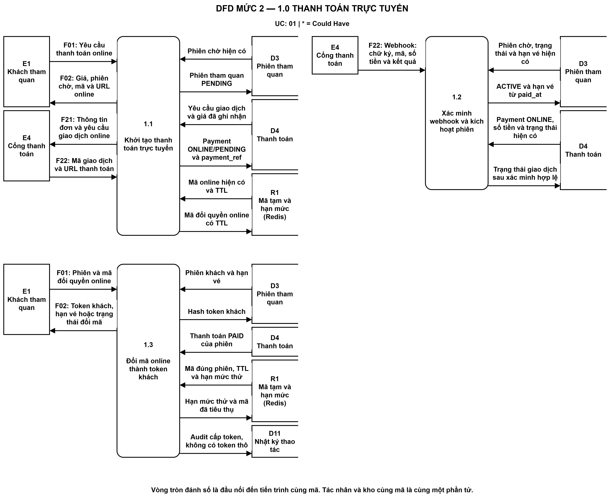
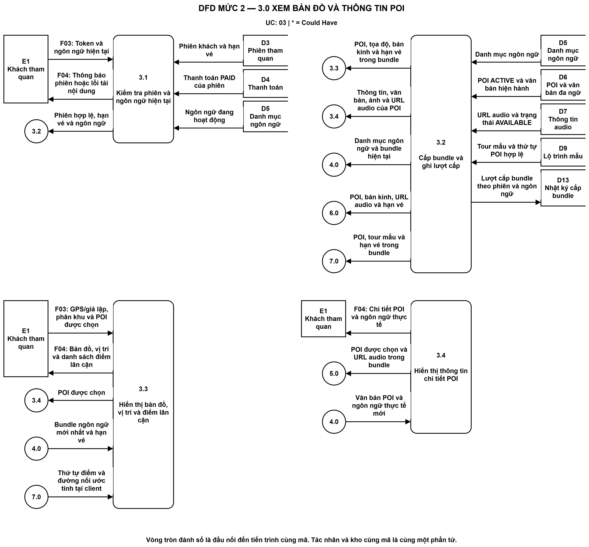
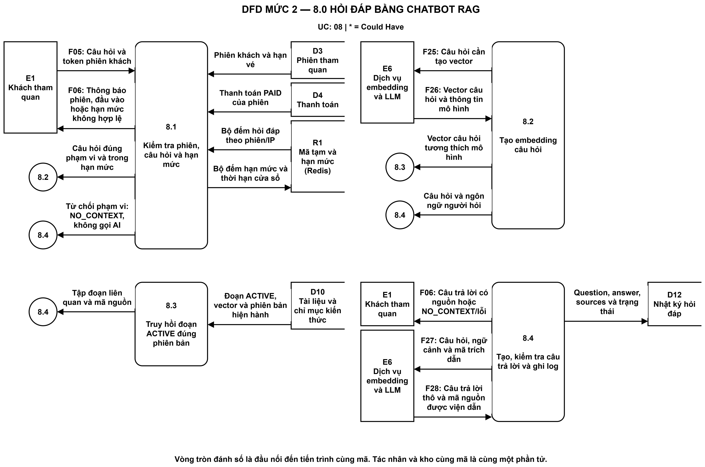
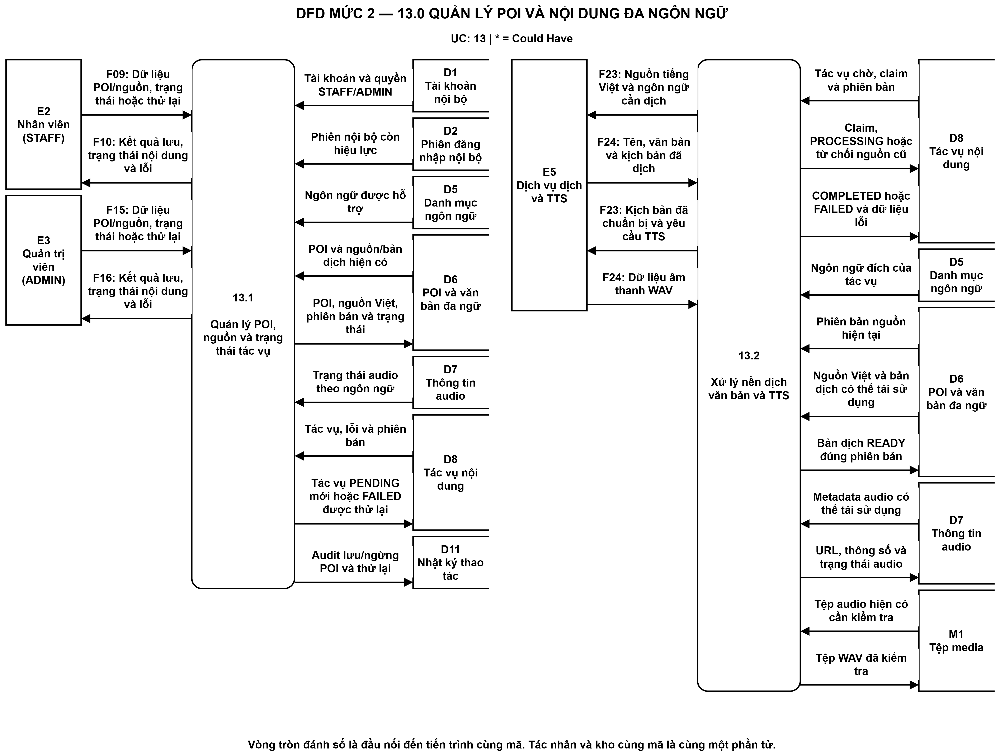
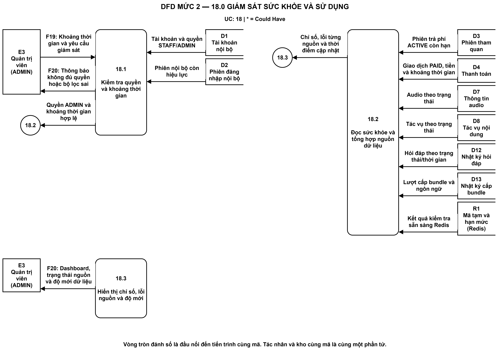
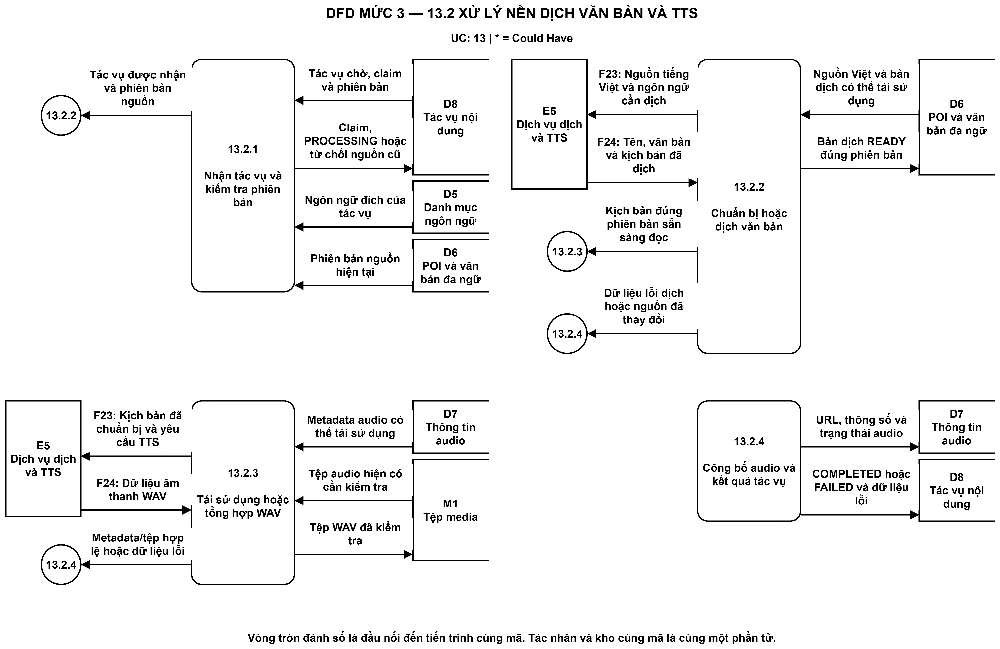
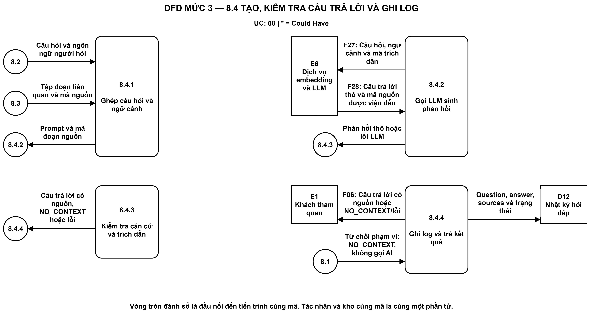

### 3.4. Sơ đồ luồng dữ liệu DFD

Phần này phân tích các luồng theo UC-01–UC-18 và QT-01–QT-14 của báo cáo Thảo Cầm Viên Sài Gòn. Ranh giới gồm web khách, giao diện nội bộ, backend, MySQL, Redis và media; GPS, phát audio và tour tùy chỉnh nằm tại client. Mức 1 có đúng 18 chức năng tương ứng 18 Use Case. Có 13 kho SQL logic ánh xạ 16 bảng, tách Redis và tệp media.

#### 3.4.1. Sơ đồ DFD mức 0

Sơ đồ mức 0 biểu diễn một tiến trình hệ thống và sáu tác nhân ngoài. Các họ F01–F28 bao gồm dữ liệu xác thực/đăng xuất của STAFF và ADMIN, quyền ADMIN kế thừa STAFF, thanh toán, nội dung, embedding câu hỏi/tài liệu và phản hồi LLM. Bảng thành phần cho phép gộp/tách luồng khi phân rã mà không mất dữ liệu.

*Hình 3.38: Sơ đồ DFD mức 0 ngữ cảnh hệ thống*

*Bảng 3.19: Bảng mô tả luồng dữ liệu DFD mức 0*

| Mã họ luồng | Hướng truyền dữ liệu | Tên luồng dữ liệu | Thành phần nghiệp vụ |
| :--- | :--- | :--- | :--- |
| F01 | Khách tham quan → Hệ thống (0) | Yêu cầu thanh toán và đổi mã | Yêu cầu thanh toán online; Phiên và mã đổi quyền online; Yêu cầu tiền mặt, phiên và mã ngắn; Phiên và mã nhận vé REISSUE* |
| F02 | Hệ thống (0) → Khách tham quan | Thông tin thanh toán và quyền tham quan | Giá, phiên chờ, mã và URL online; Token khách, hạn vé hoặc trạng thái đổi mã; Phiên chờ, trạng thái hoặc token và hạn vé; Token mới giữ nguyên hạn vé* |
| F21 | Hệ thống (0) → Cổng thanh toán | Yêu cầu khởi tạo giao dịch online | Thông tin đơn và yêu cầu giao dịch online |
| F22 | Cổng thanh toán → Hệ thống (0) | Thông tin giao dịch và kết quả thanh toán | Mã giao dịch và URL thanh toán; Webhook: chữ ký, mã, số tiền và kết quả |
| F07 | Nhân viên (STAFF) → Hệ thống (0) | Dữ liệu thanh toán tiền mặt và cấp lại quyền | Session_id, yêu cầu tạo phiên và xác nhận tiền mặt; Thông tin đối chiếu, lý do và xác nhận cấp lại* |
| F08 | Hệ thống (0) → Nhân viên (STAFF) | Phiên, kết quả xác nhận và mã nhận vé | Thông tin đối chiếu, xác nhận và mã nhận vé 6 số; Kết quả đối chiếu, mã nhận vé, hạn vé và số lần còn lại* |
| F13 | Quản trị viên (ADMIN) → Hệ thống (0) | Dữ liệu tiền mặt và cấp lại quyền của ADMIN | Session_id, yêu cầu tạo phiên và xác nhận tiền mặt; Thông tin đối chiếu, lý do và xác nhận cấp lại* |
| F14 | Hệ thống (0) → Quản trị viên (ADMIN) | Phiên, kết quả tiền mặt và mã nhận vé | Thông tin đối chiếu, xác nhận và mã nhận vé 6 số; Kết quả đối chiếu, mã nhận vé, hạn vé và số lần còn lại* |
| F03 | Khách tham quan → Hệ thống (0) | Yêu cầu nội dung, ngôn ngữ, GPS, audio và tour | Token và ngôn ngữ hiện tại; GPS/giả lập, phân khu và POI được chọn; Token và mã ngôn ngữ được chọn; POI, yêu cầu phát, tạm dừng hoặc tua; Bắt đầu tham quan và GPS/giả lập; Tour mẫu, các điểm chọn và điểm xuất phát |
| F04 | Hệ thống (0) → Khách tham quan | Nội dung, audio, lộ trình hoặc thông báo | Thông báo phiên hoặc lỗi tải nội dung; Bản đồ, vị trí và danh sách điểm lân cận; Chi tiết POI và ngôn ngữ thực tế; Bundle ngôn ngữ mới hoặc thông báo giữ ngôn ngữ cũ; Âm thanh WAV và trạng thái phát thực tế; Âm thanh tự phát và trạng thái hoặc lỗi; Thứ tự điểm, đường nối và khoảng cách ước tính |
| F05 | Khách tham quan → Hệ thống (0) | Câu hỏi tra cứu | Câu hỏi và token phiên khách |
| F06 | Hệ thống (0) → Khách tham quan | Câu trả lời có nguồn hoặc thông báo | Thông báo phiên, đầu vào hoặc hạn mức không hợp lệ; Câu trả lời có nguồn hoặc NO_CONTEXT/lỗi |
| F25 | Hệ thống (0) → Dịch vụ embedding và LLM | Câu hỏi hoặc đoạn tài liệu cần embedding | Câu hỏi cần tạo vector; Các đoạn tài liệu cần tạo vector |
| F26 | Dịch vụ embedding và LLM → Hệ thống (0) | Vector embedding tương ứng | Vector câu hỏi và thông tin mô hình; Vector các đoạn và thông tin mô hình |
| F27 | Hệ thống (0) → Dịch vụ embedding và LLM | Câu hỏi kèm ngữ cảnh và mã nguồn | Câu hỏi, ngữ cảnh và mã trích dẫn |
| F28 | Dịch vụ embedding và LLM → Hệ thống (0) | Phản hồi LLM theo ngữ cảnh | Câu trả lời thô và mã nguồn được viện dẫn |
| F11 | Nhân viên (STAFF) → Hệ thống (0) | Thông tin đăng nhập, refresh và đăng xuất | Email/mật khẩu hoặc dữ liệu refresh; Thông tin phiên cần đăng xuất |
| F12 | Hệ thống (0) → Nhân viên (STAFF) | Kết quả xác thực và kết thúc phiên | Tài khoản, vai trò và token nội bộ; Kết quả kết thúc phiên hiện tại |
| F17 | Quản trị viên (ADMIN) → Hệ thống (0) | Thông tin xác thực và đăng xuất ADMIN | Email/mật khẩu hoặc dữ liệu refresh; Thông tin phiên cần đăng xuất |
| F18 | Hệ thống (0) → Quản trị viên (ADMIN) | Kết quả xác thực và kết thúc phiên ADMIN | Tài khoản, vai trò và token nội bộ; Kết quả kết thúc phiên hiện tại |
| F09 | Nhân viên (STAFF) → Hệ thống (0) | Dữ liệu POI, tour mẫu và tài liệu | Dữ liệu POI/nguồn, trạng thái hoặc thử lại; Yêu cầu xem, tạo hoặc cập nhật tour mẫu; Tài liệu, nguồn và yêu cầu quản lý chỉ mục |
| F10 | Hệ thống (0) → Nhân viên (STAFF) | Kết quả quản lý nội dung | Kết quả lưu, trạng thái nội dung và lỗi; Tour và kết quả lưu thứ tự POI; Tài liệu, phiên bản và kết quả chỉ mục |
| F15 | Quản trị viên (ADMIN) → Hệ thống (0) | Dữ liệu quản lý nội dung của ADMIN | Dữ liệu POI/nguồn, trạng thái hoặc thử lại; Yêu cầu xem, tạo hoặc cập nhật tour mẫu; Tài liệu, nguồn và yêu cầu quản lý chỉ mục |
| F16 | Hệ thống (0) → Quản trị viên (ADMIN) | Kết quả quản lý nội dung cho ADMIN | Kết quả lưu, trạng thái nội dung và lỗi; Tour và kết quả lưu thứ tự POI; Tài liệu, phiên bản và kết quả chỉ mục |
| F23 | Hệ thống (0) → Dịch vụ dịch và TTS | Văn bản nguồn hoặc kịch bản cần dịch/TTS | Nguồn tiếng Việt và ngôn ngữ cần dịch; Kịch bản đã chuẩn bị và yêu cầu TTS |
| F24 | Dịch vụ dịch và TTS → Hệ thống (0) | Bản dịch hoặc dữ liệu âm thanh WAV | Tên, văn bản và kịch bản đã dịch; Dữ liệu âm thanh WAV |
| F19 | Quản trị viên (ADMIN) → Hệ thống (0) | Hồ sơ STAFF và bộ lọc audit, monitoring | Hồ sơ nhân viên cần tạo; Bộ lọc và trang nhật ký; Khoảng thời gian và yêu cầu giám sát |
| F20 | Hệ thống (0) → Quản trị viên (ADMIN) | Hồ sơ đã tạo, nhật ký và chỉ số | Hồ sơ STAFF đã tạo; Nhật ký thao tác và phân trang; Thông báo không đủ quyền hoặc bộ lọc sai; Dashboard, trạng thái nguồn và độ mới dữ liệu |

---

#### 3.4.2. Sơ đồ DFD mức 1

Sơ đồ mức 1 có 18 tiến trình đánh số 1.0–18.0, tương ứng lần lượt UC-01–UC-18 và giữ nguyên tên chức năng trong đặc tả. Thanh toán online, tiền mặt, lựa chọn ngôn ngữ, nghe thủ công, nghe tự động và từng chức năng nội bộ đều là các tiến trình riêng. Các tiến trình trao đổi dữ liệu trực tiếp theo nghiệp vụ, không dùng đăng nhập hoặc quản lý POI để điều phối yêu cầu khác.

*Hình 3.39: Sơ đồ DFD mức 1 phân rã toàn hệ thống*

*Bảng 3.20: Ánh xạ kho dữ liệu logic với cấu trúc lưu trữ vật lý*

| Mã kho | Tên kho logic | Lưu trữ vật lý | Phạm vi sử dụng |
| :--- | :--- | :--- | :--- |
| D1 | Tài khoản nội bộ | USERS | Dữ liệu nghiệp vụ Chương 4 |
| D2 | Phiên đăng nhập nội bộ | REFRESH_TOKENS | Dữ liệu nghiệp vụ Chương 4 |
| D3 | Phiên tham quan | VISIT_SESSIONS | Dữ liệu nghiệp vụ Chương 4 |
| D4 | Thanh toán | PAYMENTS | Dữ liệu nghiệp vụ Chương 4 |
| D5 | Danh mục ngôn ngữ | LANGUAGES | Dữ liệu nghiệp vụ Chương 4 |
| D6 | POI và văn bản đa ngữ | POIS, POI_TRANSLATIONS | Dữ liệu nghiệp vụ Chương 4 |
| D7 | Thông tin audio | AUDIOS | Dữ liệu nghiệp vụ Chương 4 |
| D8 | Tác vụ nội dung | CONTENT_JOBS | Dữ liệu nghiệp vụ Chương 4 |
| D9 | Lộ trình mẫu | TOURS, TOUR_POIS | Dữ liệu nghiệp vụ Chương 4 |
| D10 | Tài liệu và chỉ mục kiến thức | KNOWLEDGE_DOCUMENTS, KNOWLEDGE_CHUNKS | Dữ liệu nghiệp vụ Chương 4 |
| D11 | Nhật ký thao tác | AUDIT_LOGS | Dữ liệu nghiệp vụ Chương 4 |
| D12 | Nhật ký hỏi đáp | CHAT_LOGS | Dữ liệu nghiệp vụ Chương 4 |
| D13 | Nhật ký cấp bundle | BUNDLE_ACCESS_LOGS | Dữ liệu nghiệp vụ Chương 4 |
| R1 | Mã tạm và hạn mức (Redis) | Redis có TTL | Mã tạm và hạn mức; tách khỏi MySQL |
| M1 | Tệp media | Kho tệp media | Byte tệp; metadata nằm ở AUDIOS/POI |

Các kho D1–D13 có ánh xạ vật lý trong Bảng 3.20; R1 là dữ liệu tạm Redis và M1 là tệp media. AUDIT_LOGS, CHAT_LOGS và BUNDLE_ACCESS_LOGS được phân biệt; monitoring đọc các bảng nghiệp vụ phù hợp. Không đưa ANALYTICS_* hoặc thu thập GPS định kỳ vào mô hình báo cáo. UC-12 vẫn là phần Could Have, bàn giao bằng mã nhận vé 6 số; các giá trị triển khai được ghi theo cấu hình.

*Bảng 3.21: Bảng mô tả 18 chức năng tương ứng 18 Use Case trong DFD mức 1*

| Số hiệu | Tên tiến trình và UC | Luồng dữ liệu đầu vào | Kho dữ liệu đọc/ghi | Luồng dữ liệu đầu ra |
| :--- | :--- | :--- | :--- | :--- |
| 1.0 | Thanh toán trực tuyến (UC-01) | Khách tham quan → Yêu cầu thanh toán online; Phiên và mã đổi quyền online; Cổng thanh toán → Mã giao dịch và URL thanh toán; Webhook: chữ ký, mã, số tiền và kết quả | Đọc D3; Đọc D4; Đọc R1; Ghi D3; Ghi D4; Ghi R1; Ghi D11 | Giá, phiên chờ, mã và URL online; Token khách, hạn vé hoặc trạng thái đổi mã → Khách tham quan; Thông tin đơn và yêu cầu giao dịch online → Cổng thanh toán |
| 2.0 | Thanh toán tiền mặt (UC-02) | Khách tham quan → Yêu cầu tiền mặt, phiên và mã ngắn | Đọc D3; Đọc D4; Đọc R1; Ghi D3; Ghi D4; Ghi R1; Ghi D11 | Phiên chờ, trạng thái hoặc token và hạn vé → Khách tham quan |
| 3.0 | Xem bản đồ và thông tin POI (UC-03) | Khách tham quan → Token và ngôn ngữ hiện tại; GPS/giả lập, phân khu và POI được chọn; 4.0 → Bundle ngôn ngữ mới nhất và hạn vé; Văn bản POI và ngôn ngữ thực tế mới; 7.0 → Thứ tự điểm và đường nối ước tính tại client | Đọc D3; Đọc D4; Đọc D5; Đọc D6; Đọc D7; Đọc D9; Ghi D13 | Thông báo phiên hoặc lỗi tải nội dung; Bản đồ, vị trí và danh sách điểm lân cận; Chi tiết POI và ngôn ngữ thực tế → Khách tham quan; Danh mục ngôn ngữ và bundle hiện tại → 4.0; POI được chọn và URL audio trong bundle → 5.0; POI, bán kính, URL audio và hạn vé → 6.0; POI, tour mẫu và hạn vé trong bundle → 7.0 |
| 4.0 | Lựa chọn ngôn ngữ (UC-04) | 3.0 → Danh mục ngôn ngữ và bundle hiện tại; Khách tham quan → Token và mã ngôn ngữ được chọn | Đọc D3; Đọc D4; Đọc D5; Đọc D6; Đọc D7; Đọc D9; Ghi D13 | Bundle ngôn ngữ mới hoặc thông báo giữ ngôn ngữ cũ → Khách tham quan; Bundle ngôn ngữ mới nhất và hạn vé; Văn bản POI và ngôn ngữ thực tế mới → 3.0; URL audio mới và trạng thái hủy audio cũ → 5.0; POI, URL audio ngôn ngữ mới và hạn vé → 6.0; POI và tour mẫu trong bundle ngôn ngữ mới → 7.0 |
| 5.0 | Nghe thuyết minh thủ công (UC-05) | 3.0 → POI được chọn và URL audio trong bundle; 4.0 → URL audio mới và trạng thái hủy audio cũ; Khách tham quan → POI, yêu cầu phát, tạm dừng hoặc tua | Đọc M1 | Âm thanh WAV và trạng thái phát thực tế → Khách tham quan |
| 6.0 | Nghe thuyết minh tự động theo vị trí (UC-06) | 3.0 → POI, bán kính, URL audio và hạn vé; 4.0 → POI, URL audio ngôn ngữ mới và hạn vé; Khách tham quan → Bắt đầu tham quan và GPS/giả lập | Đọc M1 | Âm thanh tự phát và trạng thái hoặc lỗi → Khách tham quan |
| 7.0 | Lựa chọn và tùy chỉnh lộ trình (UC-07) | 3.0 → POI, tour mẫu và hạn vé trong bundle; 4.0 → POI và tour mẫu trong bundle ngôn ngữ mới; Khách tham quan → Tour mẫu, các điểm chọn và điểm xuất phát |  | Thứ tự điểm, đường nối và khoảng cách ước tính → Khách tham quan; Thứ tự điểm và đường nối ước tính tại client → 3.0 |
| 8.0 | Hỏi đáp bằng chatbot RAG (UC-08) | Khách tham quan → Câu hỏi và token phiên khách; Dịch vụ embedding và LLM → Vector câu hỏi và thông tin mô hình; Dịch vụ embedding và LLM → Câu trả lời thô và mã nguồn được viện dẫn | Đọc D3; Đọc D4; Đọc R1; Ghi R1; Đọc D10; Ghi D12 | Thông báo phiên, đầu vào hoặc hạn mức không hợp lệ; Câu trả lời có nguồn hoặc NO_CONTEXT/lỗi → Khách tham quan; Câu hỏi cần tạo vector → Dịch vụ embedding và LLM; Câu hỏi, ngữ cảnh và mã trích dẫn → Dịch vụ embedding và LLM |
| 9.0 | Đăng nhập nội bộ (UC-09) | Nhân viên (STAFF) → Email/mật khẩu hoặc dữ liệu refresh; Quản trị viên (ADMIN) → Email/mật khẩu hoặc dữ liệu refresh | Đọc D1; Ghi D1; Đọc D2; Ghi D2 | Tài khoản, vai trò và token nội bộ → Nhân viên (STAFF); Tài khoản, vai trò và token nội bộ → Quản trị viên (ADMIN) |
| 10.0 | Đăng xuất nội bộ (UC-10) | Nhân viên (STAFF) → Thông tin phiên cần đăng xuất; Quản trị viên (ADMIN) → Thông tin phiên cần đăng xuất | Đọc D2; Ghi D2 | Kết quả kết thúc phiên hiện tại → Nhân viên (STAFF); Kết quả kết thúc phiên hiện tại → Quản trị viên (ADMIN) |
| 11.0 | Xác nhận thanh toán tiền mặt (UC-11) | Nhân viên (STAFF) → Session_id, yêu cầu tạo phiên và xác nhận tiền mặt; Quản trị viên (ADMIN) → Session_id, yêu cầu tạo phiên và xác nhận tiền mặt | Đọc D1; Đọc D2; Đọc D3; Đọc D4; Đọc R1; Ghi D3; Ghi D4; Ghi R1; Ghi D11 | Thông tin đối chiếu, xác nhận và mã nhận vé 6 số → Nhân viên (STAFF); Thông tin đối chiếu, xác nhận và mã nhận vé 6 số → Quản trị viên (ADMIN) |
| 12.0 | Cấp lại token khách (UC-12) | Nhân viên (STAFF) → Thông tin đối chiếu, lý do và xác nhận cấp lại*; Quản trị viên (ADMIN) → Thông tin đối chiếu, lý do và xác nhận cấp lại*; Khách tham quan → Phiên và mã nhận vé REISSUE* | Đọc D1; Đọc D2; Đọc D3; Đọc D4; Đọc R1; Ghi D3; Ghi R1; Ghi D11 | Kết quả đối chiếu, mã nhận vé, hạn vé và số lần còn lại* → Nhân viên (STAFF); Kết quả đối chiếu, mã nhận vé, hạn vé và số lần còn lại* → Quản trị viên (ADMIN); Token mới giữ nguyên hạn vé* → Khách tham quan |
| 13.0 | Quản lý POI và nội dung đa ngôn ngữ (UC-13) | Nhân viên (STAFF) → Dữ liệu POI/nguồn, trạng thái hoặc thử lại; Quản trị viên (ADMIN) → Dữ liệu POI/nguồn, trạng thái hoặc thử lại; Dịch vụ dịch và TTS → Tên, văn bản và kịch bản đã dịch; Dữ liệu âm thanh WAV | Đọc D1; Đọc D2; Đọc D5; Đọc D6; Đọc D7; Đọc D8; Ghi D6; Ghi D8; Ghi D11; Đọc M1; Ghi M1; Ghi D7 | Kết quả lưu, trạng thái nội dung và lỗi → Nhân viên (STAFF); Kết quả lưu, trạng thái nội dung và lỗi → Quản trị viên (ADMIN); Nguồn tiếng Việt và ngôn ngữ cần dịch; Kịch bản đã chuẩn bị và yêu cầu TTS → Dịch vụ dịch và TTS |
| 14.0 | Quản lý lộ trình mẫu (UC-14) | Nhân viên (STAFF) → Yêu cầu xem, tạo hoặc cập nhật tour mẫu; Quản trị viên (ADMIN) → Yêu cầu xem, tạo hoặc cập nhật tour mẫu | Đọc D1; Đọc D2; Đọc D6; Đọc D9; Ghi D9; Ghi D11 | Tour và kết quả lưu thứ tự POI → Nhân viên (STAFF); Tour và kết quả lưu thứ tự POI → Quản trị viên (ADMIN) |
| 15.0 | Quản lý kho kiến thức (UC-15) | Nhân viên (STAFF) → Tài liệu, nguồn và yêu cầu quản lý chỉ mục; Quản trị viên (ADMIN) → Tài liệu, nguồn và yêu cầu quản lý chỉ mục; Dịch vụ embedding và LLM → Vector các đoạn và thông tin mô hình | Đọc D1; Đọc D2; Đọc D10; Ghi D10; Ghi D11 | Tài liệu, phiên bản và kết quả chỉ mục → Nhân viên (STAFF); Tài liệu, phiên bản và kết quả chỉ mục → Quản trị viên (ADMIN); Các đoạn tài liệu cần tạo vector → Dịch vụ embedding và LLM |
| 16.0 | Tạo tài khoản STAFF (UC-16) | Quản trị viên (ADMIN) → Hồ sơ nhân viên cần tạo | Đọc D1; Đọc D2; Ghi D1; Ghi D11 | Hồ sơ STAFF đã tạo → Quản trị viên (ADMIN) |
| 17.0 | Xem nhật ký thao tác (UC-17) | Quản trị viên (ADMIN) → Bộ lọc và trang nhật ký | Đọc D1; Đọc D2; Đọc D11 | Nhật ký thao tác và phân trang → Quản trị viên (ADMIN) |
| 18.0 | Giám sát sức khỏe và sử dụng (UC-18) | Quản trị viên (ADMIN) → Khoảng thời gian và yêu cầu giám sát | Đọc D1; Đọc D2; Đọc D3; Đọc D4; Đọc D7; Đọc D8; Đọc D12; Đọc D13; Đọc R1 | Thông báo không đủ quyền hoặc bộ lọc sai; Dashboard, trạng thái nguồn và độ mới dữ liệu → Quản trị viên (ADMIN) |

---

#### 3.4.3. Sơ đồ DFD mức 2

Mức 2 trình bày chi tiết năm chức năng có xử lý nhiều bước: 1.0 (UC-01), 3.0 (UC-03), 8.0 (UC-08), 13.0 (UC-13) và 18.0 (UC-18). Mỗi sơ đồ chỉ phân rã đúng một tiến trình cha; 13 chức năng còn lại giữ ở mức 1. Các đầu nối đánh số biểu diễn dữ liệu đến hoặc từ tiến trình cùng mã.

a. Phân rã tiến trình 1.0 Thanh toán trực tuyến

Tiến trình 1.0 tương ứng UC-01, phân rã thành 1.1 khởi tạo online, 1.2 xác minh webhook/kích hoạt phiên và 1.3 đổi mã một lần. Thanh toán tiền mặt, xác nhận tiền mặt và cấp lại token là các chức năng riêng 2.0, 11.0 và 12.0 ở mức 1.

*Hình 3.40: Sơ đồ DFD mức 2 tiến trình 1.0 Thanh toán trực tuyến*

*Bảng 3.22: Các tiến trình con của 1.0 Thanh toán trực tuyến*

| Số hiệu | Tên tiến trình và UC | Luồng dữ liệu đầu vào | Xử lý nghiệp vụ | Luồng dữ liệu đầu ra |
| :--- | :--- | :--- | :--- | :--- |
| 1.1 | Khởi tạo thanh toán trực tuyến (UC-01) | Khách tham quan → Yêu cầu thanh toán online; Cổng thanh toán → Mã giao dịch và URL thanh toán; D3 → Phiên chờ hiện có; D4 → Yêu cầu giao dịch và giá đã ghi nhận; R1 → Mã online hiện có và TTL | Giá do server xác định; tạo hoặc dùng lại phiên ONLINE/PENDING, payment_ref và mã đổi quyền có TTL. Trả URL hợp lệ. | Giá, phiên chờ, mã và URL online → Khách tham quan; Thông tin đơn và yêu cầu giao dịch online → Cổng thanh toán; Phiên tham quan PENDING → D3; Payment ONLINE/PENDING và payment_ref → D4; Mã đổi quyền online có TTL → R1 |
| 1.2 | Xác minh webhook và kích hoạt phiên (UC-01) | Cổng thanh toán → Webhook: chữ ký, mã, số tiền và kết quả; D3 → Phiên chờ, trạng thái và hạn vé hiện có; D4 → Payment ONLINE, số tiền và trạng thái hiện có | Xác minh chữ ký, mã và số tiền; cập nhật PAID/ACTIVE cùng giao dịch, chống webhook lặp; redirect không cấp quyền. | Trạng thái giao dịch sau xác minh hợp lệ → D4; ACTIVE và hạn vé từ paid_at → D3 |
| 1.3 | Đổi mã online thành token khách (UC-01) | Khách tham quan → Phiên và mã đổi quyền online; D3 → Phiên khách và hạn vé; D4 → Thanh toán PAID của phiên; R1 → Mã đúng phiên, TTL và hạn mức thử | Chỉ đổi mã một lần khi payment PAID và vé còn hạn; kiểm soát TTL, hạn mức và đồng thời; giữ mã khi còn PENDING. | Token khách, hạn vé hoặc trạng thái đổi mã → Khách tham quan; Hash token khách → D3; Hạn mức thử và mã đã tiêu thụ → R1; Audit cấp token, không có token thô → D11 |

b. Phân rã tiến trình 3.0 Xem bản đồ và thông tin POI

Tiến trình 3.0 tương ứng UC-03, phân rã thành 3.1 kiểm tra phiên/ngôn ngữ, 3.2 cấp bundle, 3.3 hiển thị bản đồ/vị trí và 3.4 hiển thị chi tiết POI. Chức năng 4.0 đổi ngôn ngữ cung cấp bundle mới; 5.0 nghe thủ công, 6.0 nghe tự động và 7.0 chọn/tùy chỉnh lộ trình là các tiến trình riêng. GPS và lộ trình cá nhân không ghi vào SQL.

*Hình 3.41: Sơ đồ DFD mức 2 tiến trình 3.0 Xem bản đồ và thông tin POI*

*Bảng 3.23: Các tiến trình con của 3.0 Xem bản đồ và thông tin POI*

| Số hiệu | Tên tiến trình và UC | Luồng dữ liệu đầu vào | Xử lý nghiệp vụ | Luồng dữ liệu đầu ra |
| :--- | :--- | :--- | :--- | :--- |
| 3.1 | Kiểm tra phiên và ngôn ngữ hiện tại (UC-03) | Khách tham quan → Token và ngôn ngữ hiện tại; D3 → Phiên khách và hạn vé; D4 → Thanh toán PAID của phiên; D5 → Ngôn ngữ đang hoạt động | Kiểm tra phiên trả phí còn hạn và ngôn ngữ đang hoạt động; từ chối lỗi trước khi tải bundle. | Thông báo phiên hoặc lỗi tải nội dung → Khách tham quan; Phiên hợp lệ, hạn vé và ngôn ngữ → 3.2 |
| 3.2 | Cấp bundle và ghi lượt cấp (UC-03) | 3.1 → Phiên hợp lệ, hạn vé và ngôn ngữ; D5 → Danh mục ngôn ngữ; D6 → POI ACTIVE và văn bản hiện hành; D7 → URL audio và trạng thái AVAILABLE; D9 → Tour mẫu và thứ tự POI hợp lệ | Đọc POI/văn bản/audio/tour hiện hành, cấp bundle chứa URL và ghi BUNDLE_ACCESS_LOGS khi thành công. | Lượt cấp bundle theo phiên và ngôn ngữ → D13; POI, tọa độ, bán kính và hạn vé trong bundle → 3.3; Thông tin, văn bản, ảnh và URL audio của POI → 3.4; Danh mục ngôn ngữ và bundle hiện tại → 4.0; POI, bán kính, URL audio và hạn vé → 6.0; POI, tour mẫu và hạn vé trong bundle → 7.0 |
| 3.3 | Hiển thị bản đồ, vị trí và điểm lân cận (UC-03) | 3.2 → POI, tọa độ, bán kính và hạn vé trong bundle; Khách tham quan → GPS/giả lập, phân khu và POI được chọn; 4.0 → Bundle ngôn ngữ mới nhất và hạn vé; 7.0 → Thứ tự điểm và đường nối ước tính tại client | Hiển thị bản đồ, lọc phân khu, xử lý GPS/giả lập và khoảng cách tại client; không gửi GPS định kỳ. | Bản đồ, vị trí và danh sách điểm lân cận → Khách tham quan; POI được chọn → 3.4 |
| 3.4 | Hiển thị thông tin chi tiết POI (UC-03) | 3.2 → Thông tin, văn bản, ảnh và URL audio của POI; 3.3 → POI được chọn; 4.0 → Văn bản POI và ngôn ngữ thực tế mới | Hiển thị đúng POI được chọn; fallback văn bản Anh rồi Việt có nhãn; cung cấp URL audio cho UC-05. | Chi tiết POI và ngôn ngữ thực tế → Khách tham quan; POI được chọn và URL audio trong bundle → 5.0 |

c. Phân rã tiến trình 8.0 Hỏi đáp bằng chatbot RAG

Tiến trình 8.0 tương ứng UC-08, phân rã thành 8.1 kiểm tra phiên/câu hỏi/hạn mức, 8.2 tạo embedding, 8.3 truy hồi nguồn ACTIVE đúng phiên bản và 8.4 tổng hợp câu trả lời có nguồn, ghi CHAT_LOGS. Tạo vector câu hỏi diễn ra trước truy hồi; gọi LLM diễn ra sau khi có ngữ cảnh.

*Hình 3.42: Sơ đồ DFD mức 2 tiến trình 8.0 Hỏi đáp bằng chatbot RAG*

*Bảng 3.24: Các tiến trình con của 8.0 Hỏi đáp bằng chatbot RAG*

| Số hiệu | Tên tiến trình và UC | Luồng dữ liệu đầu vào | Xử lý nghiệp vụ | Luồng dữ liệu đầu ra |
| :--- | :--- | :--- | :--- | :--- |
| 8.1 | Kiểm tra phiên, câu hỏi và hạn mức (UC-08) | Khách tham quan → Câu hỏi và token phiên khách; D3 → Phiên khách và hạn vé; D4 → Thanh toán PAID của phiên; R1 → Bộ đếm hỏi đáp theo phiên/IP | Kiểm tra phiên, câu hỏi và hạn mức Redis theo phiên/IP; từ chối phạm vi với NO_CONTEXT trước khi gọi AI. | Thông báo phiên, đầu vào hoặc hạn mức không hợp lệ → Khách tham quan; Bộ đếm hạn mức và thời hạn cửa sổ → R1; Câu hỏi đúng phạm vi và trong hạn mức → 8.2; Từ chối phạm vi: NO_CONTEXT, không gọi AI → 8.4 |
| 8.2 | Tạo embedding câu hỏi (UC-08) | 8.1 → Câu hỏi đúng phạm vi và trong hạn mức; Dịch vụ embedding và LLM → Vector câu hỏi và thông tin mô hình | Tạo embedding câu hỏi và kiểm tra mô hình/vector tương thích; chưa gọi LLM ở bước này. | Câu hỏi cần tạo vector → Dịch vụ embedding và LLM; Vector câu hỏi tương thích mô hình → 8.3; Câu hỏi và ngôn ngữ người hỏi → 8.4 |
| 8.3 | Truy hồi đoạn ACTIVE đúng phiên bản (UC-08) | 8.2 → Vector câu hỏi tương thích mô hình; D10 → Đoạn ACTIVE, vector và phiên bản hiện hành | Truy hồi các đoạn của tài liệu ACTIVE, đúng source_version/content_version và mô hình embedding. | Tập đoạn liên quan và mã nguồn → 8.4 |
| 8.4 | Tạo, kiểm tra câu trả lời và ghi log (UC-08) | 8.1 → Từ chối phạm vi: NO_CONTEXT, không gọi AI; 8.2 → Câu hỏi và ngôn ngữ người hỏi; 8.3 → Tập đoạn liên quan và mã nguồn; Dịch vụ embedding và LLM → Câu trả lời thô và mã nguồn được viện dẫn | Ghép ngữ cảnh, gọi LLM, kiểm tra nguồn; ghi SUCCESS/NO_CONTEXT/FAILED và trả kết quả. | Câu trả lời có nguồn hoặc NO_CONTEXT/lỗi → Khách tham quan; Câu hỏi, ngữ cảnh và mã trích dẫn → Dịch vụ embedding và LLM; Question, answer, sources và trạng thái → D12 |

d. Phân rã tiến trình 13.0 Quản lý POI và nội dung đa ngôn ngữ

Tiến trình 13.0 tương ứng UC-13, phân rã thành 13.1 quản lý POI/nguồn/trạng thái và 13.2 pipeline dịch–TTS. Quản lý lộ trình mẫu và kho kiến thức là chức năng riêng 14.0 và 15.0 ở mức 1. Tác vụ nền đọc CONTENT_JOBS; bản dịch, byte WAV, metadata và trạng thái có luồng lưu riêng.

*Hình 3.43: Sơ đồ DFD mức 2 tiến trình 13.0 Quản lý POI và nội dung đa ngôn ngữ*

*Bảng 3.25: Các tiến trình con của 13.0 Quản lý POI và nội dung đa ngôn ngữ*

| Số hiệu | Tên tiến trình và UC | Luồng dữ liệu đầu vào | Xử lý nghiệp vụ | Luồng dữ liệu đầu ra |
| :--- | :--- | :--- | :--- | :--- |
| 13.1 | Quản lý POI, nguồn và trạng thái tác vụ (UC-13) | Nhân viên (STAFF) → Dữ liệu POI/nguồn, trạng thái hoặc thử lại; Quản trị viên (ADMIN) → Dữ liệu POI/nguồn, trạng thái hoặc thử lại; D1 → Tài khoản và quyền STAFF/ADMIN; D2 → Phiên nội bộ còn hiệu lực; D5 → Ngôn ngữ được hỗ trợ; D6 → POI và nguồn/bản dịch hiện có; D7 → Trạng thái audio theo ngôn ngữ; D8 → Tác vụ, lỗi và phiên bản | Kiểm tra quyền; lưu/ngừng POI, nguồn và audit; ghi tác vụ khi nội dung liên quan đổi; chỉ thử lại FAILED hiện hành. | Kết quả lưu, trạng thái nội dung và lỗi → Nhân viên (STAFF); Kết quả lưu, trạng thái nội dung và lỗi → Quản trị viên (ADMIN); POI, nguồn Việt, phiên bản và trạng thái → D6; Tác vụ PENDING mới hoặc FAILED được thử lại → D8; Audit lưu/ngừng POI và thử lại → D11 |
| 13.2 | Xử lý nền dịch văn bản và TTS (UC-13) | D8 → Tác vụ chờ, claim và phiên bản; D5 → Ngôn ngữ đích của tác vụ; D6 → Phiên bản nguồn hiện tại; D6 → Nguồn Việt và bản dịch có thể tái sử dụng; D7 → Metadata audio có thể tái sử dụng; M1 → Tệp audio hiện có cần kiểm tra; Dịch vụ dịch và TTS → Tên, văn bản và kịch bản đã dịch; Dịch vụ dịch và TTS → Dữ liệu âm thanh WAV | Nhận tác vụ từ CONTENT_JOBS; kiểm tra phiên bản; tái sử dụng/dịch, TTS, lưu WAV và metadata đúng phiên bản. | Claim, PROCESSING hoặc từ chối nguồn cũ → D8; Bản dịch READY đúng phiên bản → D6; Tệp WAV đã kiểm tra → M1; URL, thông số và trạng thái audio → D7; COMPLETED hoặc FAILED và dữ liệu lỗi → D8; Nguồn tiếng Việt và ngôn ngữ cần dịch → Dịch vụ dịch và TTS; Kịch bản đã chuẩn bị và yêu cầu TTS → Dịch vụ dịch và TTS |

e. Phân rã tiến trình 18.0 Giám sát sức khỏe và sử dụng

Tiến trình 18.0 tương ứng UC-18, phân rã thành 18.1 kiểm tra quyền/khoảng thời gian, 18.2 đọc sức khỏe/tổng hợp dữ liệu và 18.3 hiển thị chỉ số/lỗi nguồn/độ mới. Đăng nhập, đăng xuất, tạo STAFF và xem audit là chức năng riêng 9.0, 10.0, 16.0 và 17.0 ở mức 1. Monitoring chỉ đọc nguồn nghiệp vụ, không sửa dữ liệu.

*Hình 3.44: Sơ đồ DFD mức 2 tiến trình 18.0 Giám sát sức khỏe và sử dụng*

*Bảng 3.26: Các tiến trình con của 18.0 Giám sát sức khỏe và sử dụng*

| Số hiệu | Tên tiến trình và UC | Luồng dữ liệu đầu vào | Xử lý nghiệp vụ | Luồng dữ liệu đầu ra |
| :--- | :--- | :--- | :--- | :--- |
| 18.1 | Kiểm tra quyền và khoảng thời gian (UC-18) | Quản trị viên (ADMIN) → Khoảng thời gian và yêu cầu giám sát; D1 → Tài khoản và quyền STAFF/ADMIN; D2 → Phiên nội bộ còn hiệu lực | Kiểm tra phiên, quyền ADMIN và khoảng thời gian ở mỗi request; không trả thống kê nếu mất quyền. | Thông báo không đủ quyền hoặc bộ lọc sai → Quản trị viên (ADMIN); Quyền ADMIN và khoảng thời gian hợp lệ → 18.2 |
| 18.2 | Đọc sức khỏe và tổng hợp nguồn dữ liệu (UC-18) | 18.1 → Quyền ADMIN và khoảng thời gian hợp lệ; D3 → Phiên trả phí ACTIVE còn hạn; D4 → Giao dịch PAID, tiền và khoảng thời gian; D7 → Audio theo trạng thái; D8 → Tác vụ theo trạng thái; D12 → Hỏi đáp theo trạng thái/thời gian; D13 → Lượt cấp bundle và ngôn ngữ; R1 → Kết quả kiểm tra sẵn sàng Redis | Đọc liveness/readiness và các bảng nghiệp vụ; tổng hợp đúng khoảng thời gian, giữ riêng lỗi từng nguồn. | Chỉ số, lỗi từng nguồn và thời điểm cập nhật → 18.3 |
| 18.3 | Hiển thị chỉ số, lỗi nguồn và độ mới (UC-18) | 18.2 → Chỉ số, lỗi từng nguồn và thời điểm cập nhật | Hiển thị chỉ số, đơn vị, khoảng thời gian và độ mới; polling khi trang còn mở, dừng khi rời trang; không suy lỗi thành 0. | Dashboard, trạng thái nguồn và độ mới dữ liệu → Quản trị viên (ADMIN) |

---

#### 3.4.4. Sơ đồ DFD mức 3

Mức 3 phân rã sâu tiến trình 13.2 của UC-13 và 8.4 của UC-08; các luồng biên được bảo toàn với tiến trình cha ở mức 2.

a. Phân rã tiến trình 13.2 Xử lý nền dịch văn bản và tổng hợp âm thanh

Tiến trình 13.2 gồm bốn bước: 13.2.1 nhận tác vụ/kiểm tra phiên bản, 13.2.2 chuẩn bị/dịch văn bản, 13.2.3 tái sử dụng/tổng hợp WAV và 13.2.4 công bố audio/kết quả. Dịch xong mới gửi TTS; nguồn Việt được tái sử dụng. Kết quả cũ không ghi đè phiên bản mới.

*Hình 3.45: Sơ đồ DFD mức 3 tiến trình 13.2 Xử lý nền dịch văn bản và TTS*

*Bảng 3.27: Các tiến trình con của 13.2 Xử lý nền dịch văn bản và TTS*

| Số hiệu | Tên tiến trình và UC | Luồng dữ liệu đầu vào | Xử lý nghiệp vụ | Luồng dữ liệu đầu ra |
| :--- | :--- | :--- | :--- | :--- |
| 13.2.1 | Nhận tác vụ và kiểm tra phiên bản (UC-13) | D8 → Tác vụ chờ, claim và phiên bản; D5 → Ngôn ngữ đích của tác vụ; D6 → Phiên bản nguồn hiện tại | Đọc tác vụ/ngôn ngữ/phiên bản; claim nguyên tử hoặc từ chối nguồn cũ. | Claim, PROCESSING hoặc từ chối nguồn cũ → D8; Tác vụ được nhận và phiên bản nguồn → 13.2.2 |
| 13.2.2 | Chuẩn bị hoặc dịch văn bản (UC-13) | D6 → Nguồn Việt và bản dịch có thể tái sử dụng; Dịch vụ dịch và TTS → Tên, văn bản và kịch bản đã dịch; 13.2.1 → Tác vụ được nhận và phiên bản nguồn | Dùng nguồn Việt hoặc tái sử dụng bản dịch hợp lệ; nếu cần gọi dịch, kiểm tra và lưu bản dịch đúng phiên bản. | Bản dịch READY đúng phiên bản → D6; Nguồn tiếng Việt và ngôn ngữ cần dịch → Dịch vụ dịch và TTS; Kịch bản đúng phiên bản sẵn sàng đọc → 13.2.3; Dữ liệu lỗi dịch hoặc nguồn đã thay đổi → 13.2.4 |
| 13.2.3 | Tái sử dụng hoặc tổng hợp WAV (UC-13) | D7 → Metadata audio có thể tái sử dụng; M1 → Tệp audio hiện có cần kiểm tra; Dịch vụ dịch và TTS → Dữ liệu âm thanh WAV; 13.2.2 → Kịch bản đúng phiên bản sẵn sàng đọc | Tái sử dụng audio hợp lệ hoặc gửi kịch bản đến TTS; kiểm tra WAV, lưu byte tệp vào M1. | Tệp WAV đã kiểm tra → M1; Kịch bản đã chuẩn bị và yêu cầu TTS → Dịch vụ dịch và TTS; Metadata/tệp hợp lệ hoặc dữ liệu lỗi → 13.2.4 |
| 13.2.4 | Công bố audio và kết quả tác vụ (UC-13) | 13.2.3 → Metadata/tệp hợp lệ hoặc dữ liệu lỗi; 13.2.2 → Dữ liệu lỗi dịch hoặc nguồn đã thay đổi | Kiểm tra lại phiên bản/quyền xử lý; công bố metadata và COMPLETED/FAILED, không ghi đè nguồn mới. | URL, thông số và trạng thái audio → D7; COMPLETED hoặc FAILED và dữ liệu lỗi → D8 |

b. Phân rã tiến trình 8.4 Tổng hợp câu trả lời có trích dẫn và ghi nhật ký

Tiến trình 8.4 nhận câu hỏi/ngôn ngữ từ 8.2 và các đoạn từ 8.3, phân rã thành 8.4.1 ghép prompt, 8.4.2 gọi LLM, 8.4.3 kiểm tra căn cứ/trích dẫn và 8.4.4 ghi log/trả kết quả. Nhánh từ chối phạm vi từ 8.1 đi thẳng đến ghi log/trả thông báo, không gọi AI.

*Hình 3.46: Sơ đồ DFD mức 3 tiến trình 8.4 Tổng hợp câu trả lời có nguồn và ghi nhật ký*

*Bảng 3.28: Các tiến trình con của 8.4 Tổng hợp câu trả lời có nguồn và ghi nhật ký*

| Số hiệu | Tên tiến trình và UC | Luồng dữ liệu đầu vào | Xử lý nghiệp vụ | Luồng dữ liệu đầu ra |
| :--- | :--- | :--- | :--- | :--- |
| 8.4.1 | Ghép câu hỏi và ngữ cảnh (UC-08) | 8.2 → Câu hỏi và ngôn ngữ người hỏi; 8.3 → Tập đoạn liên quan và mã nguồn | Ghép câu hỏi/ngôn ngữ từ 8.2 với đoạn kiến thức từ 8.3 thành prompt có mã nguồn. | Prompt và mã đoạn nguồn → 8.4.2 |
| 8.4.2 | Gọi LLM sinh phản hồi (UC-08) | Dịch vụ embedding và LLM → Câu trả lời thô và mã nguồn được viện dẫn; 8.4.1 → Prompt và mã đoạn nguồn | Gửi prompt đến LLM và nhận phản hồi hoặc dữ liệu lỗi có thời hạn. | Câu hỏi, ngữ cảnh và mã trích dẫn → Dịch vụ embedding và LLM; Phản hồi thô hoặc lỗi LLM → 8.4.3 |
| 8.4.3 | Kiểm tra căn cứ và trích dẫn (UC-08) | 8.4.2 → Phản hồi thô hoặc lỗi LLM | Kiểm tra căn cứ, mã trích dẫn và liên kết; xác định SUCCESS/NO_CONTEXT/FAILED. | Câu trả lời có nguồn, NO_CONTEXT hoặc lỗi → 8.4.4 |
| 8.4.4 | Ghi log và trả kết quả (UC-08) | 8.1 → Từ chối phạm vi: NO_CONTEXT, không gọi AI; 8.4.3 → Câu trả lời có nguồn, NO_CONTEXT hoặc lỗi | Ghi CHAT_LOGS không chứa secret/raw token và trả câu trả lời có nguồn hoặc thông báo phù hợp. | Câu trả lời có nguồn hoặc NO_CONTEXT/lỗi → Khách tham quan; Question, answer, sources và trạng thái → D12 |
